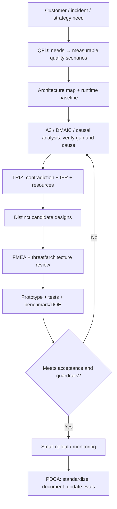

# ТРИЗ и системные методологии для разработки ПО

> [!abstract] Для чего эта страница
> Практическое руководство, как применять ТРИЗ и дополняющие методы к архитектурным,
> качественным и процессным проблемам программного продукта, а также встроить их в агентный
> workflow. Методы помогают **лучше сформулировать проблему и расширить поиск решений**; они не
> доказывают, что предложенное решение верно. Доказательство дают измерения, тесты, review и rollout.

## Выводы исследования

Углублённый разбор основных инструментов ТРИЗ, прямых аналогов в software engineering и их оценки для агентной среды вынесен отдельно: [[ТРИЗ и аналоги: карта методов для агентной разработки]] и [[Ресёрч по теориям ТРИЗ и аналогам для агентных систем]]. Здесь сохраняется исходное практическое введение и интегральный workflow.

- Самый переносимый элемент ТРИЗ в ПО — **явно формулировать конфликт целей, строить функциональную
  модель и искать ресурсы/варианты**, а не подменять инженерную работу механическим применением 40 принципов.
- Software-specific transfer нужен: физические параметры классической contradiction matrix не всегда
  корректно отображают атрибуты архитектуры, процессов и цифровых систем. Научная работа Kluender
  показывает полезные аналогии для software architecture, но отмечает частичную применимость матрицы
  и трактует principles как дополнение к архитектурным тактикам/паттернам, не их замену.
- Существуют исследования и кейсы переноса ТРИЗ на software architecture, object-oriented design,
  information systems и процессы; доказательная база разнородна и часто состоит из case studies.
  Не обещать заранее ни «инновационность», ни экономию/процент улучшения.
- Исследование по digital systems прямо отмечает разрыв между общими solution prompts TRIZ и
  конкретной инженерной реализацией: модель помогает рассуждать о проблеме, но не заменяет
  domain expertise. Это особенно важно для агентных решений, где LLM может уверенно заполнить
  этот разрыв недостоверными деталями.
- Для оптимизации существующего продукта полезно сочетание: **QFD/voice of customer → системная модель и
  метрики → A3/PDCA или DMAIC для диагностики → TRIZ для генерации альтернатив → FMEA/architecture
  fitness functions для риска → controlled experiment и CI для проверки**.
- В мультиагентной системе свободные LLM-идеи — гипотезы. Между генерацией и merge должны стоять
  domain-owner review, тесты, архитектурные/security gates и бюджет/stop rule.

## Где применимы ТРИЗ и смежные методы

| Тип задачи | Лучший старт | Роль ТРИЗ |
|---|---|---|
| Улучшить latency, сохранив correctness / reliability | Baseline + profiler + workload; DMAIC при повторяемой проблеме | Сформулировать speed-vs-quality contradiction и создать варианты, выходящие за простой trade-off |
| Рефакторинг с конфликтующими качествами | Quality Attribute Workshop / ADR / architecture fitness functions | Искать локальную структуру, разделение, перенос функции, динамичность; проверить на quality scenarios |
| Частые production incidents / повторный дефект | Incident timeline + A3/PDCA + fault tree/FMEA | Поиск коренной функции/вредного взаимодействия и ресурса для устранения причины, не латание симптома |
| Бэклог агентов растёт, delivery не ускоряется | TOC: измерить очередь/lead time, найти ограничение | Изобретать способы снять конкретный bottleneck после его локализации |
| Неясные product requirements / противоречивые запросы | QFD, интервью, product discovery | Разрешать выявленные conflicts в техническом дизайне после согласования потребностей |
| Рискованный security/privacy trade-off | Threat modeling + abuse cases + security review | Помочь искать безопасные варианты; не замещает policy, threat model и security approval |
| Новый продукт/неопределённая задача | Design thinking / prototypes / morphological analysis | Углубить генерацию концепций после понимания нужд и ограничений |
| Небольшой изолированный defect с понятным repro | Regression test, debugger, минимальный patch | Часто избыточна; не применять тяжёлую методологию по ритуалу |

## Рабочий цикл ТРИЗ для программной задачи

### 1. Задать границы системы и ее функцию

Определить объект решения: модуль/сервис/workflow/team process/agent harness; над- и подсистемы,
пользователи, границы доверия, входы/выходы, зависимости, жизненный цикл. Установить current
architecture, contracts, owners и data flows из кода/graph/telemetry. Не выводить системную модель
только из одного файла или LLM summary.

Функционально опишите действия: **кто/что действует на кого, какой полезный или вредный эффект**.
Например: `retry coordinator → повторяет запрос → downstream API` (полезно: transient recovery;
вредно при ошибке: duplicate charge). Для software это часто понятнее, чем переносить «массу» или
«длину» из физической матрицы.

### 2. Измерить gap и сформулировать проблему без solution bias

Собрать baseline и конкретные условия: workload, version, population, timeframe, test/repro,
impact/owner. Разделить symptom, mechanism, root cause и solution proposal. Измерение валидировать:
ошибка логирования, выборочная телеметрия или нерепрезентативный load test не должны считаться фактом.

### 3. Выразить техническое противоречие

Шаблон:

> Если мы делаем **X**, целевой показатель **A** улучшается, но показатель/риск **B** ухудшается,
> потому что …; система при этом должна сохранить … при условиях … .

Пример: «Если загружать в coding agent всю архитектурную документацию, повышается шанс заметить
cross-module invariant; но растут токены/latency и нерелевантные правила отвлекают. Требование:
обнаруживать relevant invariants без избыточного always-on контекста».

Сначала подтвердить, что показатели действительно связаны данными/механизмом; не назначать
противоречие лишь потому, что в задаче есть два существительных. Если конфликтуют противоположные
состояния одного элемента («данные должны быть приватны, но наблюдаемы для диагностики»),
сформулировать physical/operational contradiction: **какой элемент**, **где/когда/кем** должен иметь
каждое свойство. Это часто ведёт к разделению по scope, месту, времени, уровню доступа.

### 4. Идеальный конечный результат и ресурсы

IFR для софта лучше задавать как проверяемое свойство, не мечту «бесплатно, мгновенно, без риска»:

> Нужный эффект достигается для заданного набора случаев; вредный эффект устранён или снижен;
> нет новых неприемлемых зависимостей/операционных рисков; изменения минимальны и обратимы.

Инвентаризировать ресурсы системы: существующий код/API/cache/index/feature flag, тестовые fixtures,
telemetry, idle compute, development-time vs runtime, metadata, ownership, safe sandbox, обратная связь
пользователя. «Использовать ресурс» не значит забрать его за пределами разрешённого доступа.

### 5. Создать несколько разных вариантов

40 изобретательских принципов, separation principles, functional analysis, trimming и system evolution
можно использовать как **линзы для разнообразия идей**, но не как генератор спецификации. Отобрать
принцип только когда можете объяснить, какой механизм он предлагает в терминах данного продукта.

Часто полезные для программных систем аналогии (проверять применимость, не переносить название
буквально):

| Линза TRIZ | Возможная software realization | Что проверить |
|---|---|---|
| Segmentation / segmentation by scope | Разделить данные/context/cache/module/traffic по tenant, feature, risk tier | Нет cross-scope leak; граница тестируется |
| Taking out / extraction | Вынести редкие правила, тяжёлый query, изменчивый tool spec из hot path; lazy load | Не исчезают необходимые dependencies/observability |
| Local quality | Разные SLA/validation/context rules по criticality, не одно global setting | Сегментированный policy понятен и предсказуем |
| Prior action | Precompute index, warm cache, validate contract/input before expensive steps | Обновление/invalidations и stale data покрыты |
| Dynamicity | Runtime feature flags, adaptive budgets/routing, reversible configuration | Bounds, policy limits, rollback и eval по режимам |
| Feedback | Runtime signals adjust rate/concurrency/context budget under explicit bounds | Feedback не усиливает instability/noise; control loop tested |
| Intermediary / mediator | Queue, adapter, typed API, policy gateway, human review stage | Новый посредник не стал bottleneck/trust bypass |
| Copying / digital model | Safe simulator, shadow traffic, synthetic fixture or replay before live action | Simulation fidelity and gaps documented |
| Universality / combine | Один service/tool handles compatible responsibilities, shared primitive | Coupling, blast radius and ownership не ухудшились |
| Trimming / useful function transfer | Remove redundant layer/function or shift it into platform/runtime | Removed behavior still met by verified alternative |
| Separation in time/space/conditions | Privileged operation only in approved environment/window; store detailed data separately from model context | ACL, timing, races, retention and UX |

Не сводить цифровые architecture properties к legacy physical parameters будто mapping объективен.
Можно использовать software-specific contradiction catalog, построенный на локальных ADR/постмортемах,
но сохранять его как эвристический индекс с примерами, владельцами и датой review.

### 6. Выбрать по evidence, не по эффектности

Для каждого варианта записать: гипотезу, ожидаемый эффект, риски/побочные эффекты, архитектурный fit,
стоимость внедрения/эксплуатации, эксперимент, критерий отвержения, уровень обратимости.
Сравнить на одинаковом workload и quality scenario. Сначала дешёвые reversible prototypes; для
неясной архитектуры — ADR/прототип, для measurable tuning — benchmark/DOE, для high risk — FMEA/threat
model/owner review. Не считать candidate, предложенный несколькими одинаковыми моделями, независимым
подтверждением.

### 7. Реализовать smallest testable change и изучить результат

Зафиксировать decision/ADR, добавить regression/architecture/property test, rollout/rollback plan,
запустить deterministic gates и compare baseline. После канареечного периода записать фактический
результат и непредвиденные эффекты. Успех обновляет patterns/tests; провал — улучшает модель/диагностику,
не добавляет очередную бессрочную instruction.

## Смежные методологии: что дают и чего не дают

### A3 / PDCA — факты, причина, контрмера, обучение

Подходит для повторяющихся incidents, технического долга и cross-team problem. A3 — не только форма:
это короткая storyboard для диалога владельца проблемы, отображающая current condition → gap → cause
hypotheses → countermeasures → experiment → follow-up. В software-agent workflow сохранять её как
Markdown/issue/ADR с evidence links. Lean Enterprise Institute отдельно предупреждает: начинать с
понимания проблемы, а не с заполнения шаблона; A3 не должен становиться compliance paperwork.

PDCA:

- **Plan:** operational definition, current state, measurable target, causal hypotheses, experiment.
- **Do:** smallest bounded change / pilot.
- **Check/Study:** compare outcome to target + check side effects.
- **Act:** standardize successful change or revise hypothesis, then repeat.

### DMAIC / Six Sigma — вариация и подтверждённая причина

**Define → Measure → Analyze → Improve → Control**. Полезно, если проблема повторяется, есть достаточные
данные, существенна вариативность и простая интуиция не локализует механизм. Для софта: flaky test rate,
change failure rate, p95 latency, retry duplication, defect escape, review queue lead time. Validate
measurement and sample composition before running statistics. Не применять формальную DMAIC к простому
багу, и не выдавать корреляцию/малую выборку за причинность. Control phase превращается в CI/SLO,
owner и monitoring plan.

### Theory of Constraints (TOC) — искать текущий системный bottleneck

Пять шагов: identify → exploit → subordinate → elevate → repeat. Применять на delivery system: может
ограничивать review capacity, integration/CI, test environment, deployment approval или domain-owner
availability, а не скорость написания кода. Агентная фабрика способна увеличить upstream work-in-progress;
сначала измерить очереди и throughput, иначе ускорение генерации усугубит constraint.

### QFD / House of Quality — voice of customer → engineering measures

Переводить user/customer needs в технические characteristics, acceptance tests и приоритеты. Для software
пример: «страница ощущается быстрой» → p95 interaction latency на сценарии X; «не потерять изменения» →
инвариант durability + fault-injection test. QFD помогает видеть взаимосвязи и конфликты требований,
а TRIZ может расширить поиск решения конфликта. Не рисовать огромную матрицу для малой фичи; проверить
needs у настоящих пользователей/доменного владельца, не только дать LLM генерировать потребности.

### Systems thinking / causal loop — взаимодействия и задержки

Использовать causal-loop diagram, behavior-over-time и architecture dependency graph, когда локальная
правка меняет downstream эффект или есть feedback/delay. Пример: рост agent throughput → рост PR queue →
меньше времени reviewer на PR → больше escaped regressions → больше interrupt work → меньше capacity.
Это гипотезы о причинности, которые проверять метриками и временными рядами, а не доказывать видом
диаграммы. Не забывать о границах модели и внешних влияниях.

### FMEA / FMECA — виды отказа и барьеры

Для high-consequence features (payments, auth, data migration, safety/security, autonomous deployment)
перечислить функции, failure modes, effects, causes, detection/mitigation, owner/evidence. Для программных
функций рассматривать: absent, incorrect, incomplete, late/early, repeated, stale, unauthorized execution;
интерфейсные и взаимодействующие отказы. Использовать risk severity/likelihood/detection как обсуждение,
а не обожествлять точный RPN: high severity требует внимания даже при неопределённой вероятности.
Привязать меры к tests, monitors, policy gates и rollback. FMEA не доказательство полноты — дополнять
threat modeling, incident history и независимым review.

### Design thinking, morphological analysis и SCAMPER — расширить пространство концепций

Discovery/interview/prototype ставит пользовательскую проблему; morphological analysis комбинирует
независимые design dimensions; SCAMPER задаёт prompts (substitute, combine, adapt, modify, put to another
use, eliminate, reverse). Лучше для раннего product/design space, чем для подтверждения root cause.
Переводить идеи в prototype/acceptance test и проверять usability/behavior, не выбирать красивый concept
по уверенности агента.

### TDD / property-based testing / design by contract — превратить рассуждение в исполняемые условия

Это не ideation theory, зато essential bridge между предложением и реальным software change:
requirements → failing regression test/property/invariant → smallest implementation → refactor → CI.
Contract/preconditions/postconditions/invariants позволят агентам проверять не только текстовый ответ,
но и состояние системы. Тестовый oracle должен быть валиден, не меняться вместе с кодом без независимого review.

## Комбинированный маршрут для архитектурной оптимизации



Этот маршрут не обязателен для каждого change. Перескакивать методологию по масштабу задачи нормально;
нельзя перескакивать обязательные safety gates, если изменение рискованное.

## Многоагентная схема применения

```mermaid
flowchart LR
    OWNER[Human problem owner] --> FRAME[Orchestrator: scope, system boundary, stop rules]
    FRAME --> EVID[Read-only evidence agents: repo graph, logs, users, tests]
    EVID --> MODEL[System / function model + measurable baseline]
    MODEL --> C1[Independent contradiction framers]
    C1 --> REVIEW[Owner validates problem, metrics, assumptions]
    REVIEW --> GEN[TRIZ / QFD / TOC / A3 guided ideation]
    GEN --> CRIT[Critic: counterexamples, side effects, feasibility]
    CRIT --> SELECT[Human/owner selects experiment]
    SELECT --> PATCH[Bounded implementer in isolated worktree]
    PATCH --> VERIFY[Deterministic tests + architecture/security/perf gates]
    VERIFY -->|fail| FRAME
    VERIFY -->|pass| PILOT[Canary/rollout + observability]
    PILOT --> LEARN[Verified learning → reviewed Git change]
```



### Роли, контракты и ограничения

| Роль | Вклад | Не имеет права |
|---|---|---|
| Evidence collector | Repo graph, metrics, issue history, tests, constraints with citations | Делать causality claims без данных; менять source |
| Problem framer | Независимые formulations symptom, gap, boundary, contradiction | Решать, что предложенный fix верен |
| Domain owner/facilitator | Валидирует user impact, intent, constraints, target | Одобрять только по LLM уверенности |
| Idea agents | Несколько различных вариантов по разным lenses/solution spaces | Выдавать analogy as evidence; merge/release |
| Risk critic | FMEA/threat/side-effect checks; attempts to falsify each idea | Считать собственный review заменой gates |
| Experiment designer | Metric, baseline, sample/workload, success/failure, rollback | Подбирать metric после результата |
| Implementer | One selected bounded hypothesis, regression test | Менять acceptance oracle/gates/thresholds без approval |
| Verifier | Tests/scans/benchmarks on clean state; checks changed tests | Единственный судья своего generated patch |

Для diversity задавать действительно разные задачи: например, один агент ищет внутри текущей архитектуры,
другой — remove/transfer function, третий — operational/process countermeasure. Три агента с одним prompt,
одной моделью и одной базой не являются статистически независимой триангуляцией.

## Structured problem packet для агента

```yaml
problem_id: PERF-142
system_boundary: search API + index service + client retry policy
owner: search-platform
current_state:
  observation: p95 exceeds target during bulk indexing
  evidence: ["trace://run/abc", "benchmark://index-load/v8", "git://repo@sha"]
  confidence: measured-under-staging-workload
user_need: keep interactive queries responsive during imports
constraints: ["no dropped updates", "tenant isolation", "API compatibility"]
contradiction:
  if_improve: bulk throughput
  worsens: interactive p95 latency / shared-resource contention
  mechanism_hypothesis: "index workers saturate shared CPU pool"
  verified: false
ideal_result: imports progress without materially harming interactive latency
available_resources: ["separate queue", "existing priority scheduler", "autoscaling limits", "load fixtures"]
ideas_required:
  - "one no-new-infrastructure option"
  - "one architecture change"
  - "one operational/process option"
verification: ["bulk + interactive mixed load test", "correctness tests", "tenant isolation test"]
stop_if: ["data loss risk", "new public API", "unexplained benchmark variance"]
```

Agent should return claims separate from hypotheses and ideas, with citations/measurements, uncertainty,
assumptions, alternatives, risks and falsification test. For safety/privacy sensitive tasks, human validates
framing and solution selection; agent creativity doesn't create delegated authority.

## Evaluation and measurement of methodology

Оценивать не число TRIZ principles, заполненных templates или volume of ideas, а:

- Problem framing accuracy: owner agrees that symptom, boundary, desired state and constraints are correct.
- Evidence traceability: fraction of key claims with current source, exact test or measurement.
- Candidate diversity: materially different solution mechanisms, not paraphrases.
- Feasibility and risk: accepted ideas pass architecture/security review; side-effect coverage.
- Experiment quality: preregistered target/guardrails, reproducible baseline, no post-hoc threshold changes.
- Outcomes: task/user quality, reliability/security, performance, change failure/rollbacks, maintenance cost.
- Process cost: time, compute/tokens, reviewer minutes, CI minutes, iteration count and opportunity cost.
- Learning: confirmed failure becomes a good regression case or reviewed design knowledge; stale ideas retired.

Run paired offline task suite for method variants: (A) normal baseline workflow, (B) structured problem packet,
(C) TRIZ/system-method prompts, (D) full multi-agent method. Keep model/tool/repo snapshot fixed, randomize
run order, multiple trials, blinded reviewers; compare output quality **and** runtime/cost. With low N, report
uncertainty and examples rather than claiming superiority. Use A/B in production only for low-risk, safe-to-compare
changes and predefine guardrails. Do not A/B unsafe/security policy variants on real users.

## Anti-patterns

- Mapping an arbitrary software problem onto classic 39 physical parameters because a matrix exists.
- Starting from a principle (“apply segmentation!”) and reverse-engineering a problem to justify it.
- Framing standard quality trade-off as a contradiction before checking workload, cause and measurement.
- Treating IFR as impossible-to-measure aspiration or a promise of zero trade-offs.
- Calling a large architecture/process exercise for a small, reproducible bug.
- Letting an LLM invent users' needs, root causes, or actual architecture without owner/source evidence.
- Confusing brainstorming diversity with evidence; consensus between similar agents is not validation.
- Generating an A3/DMAIC worksheet after solution selected, solely to rationalize the decision.
- Optimizing a local metric (agent throughput, p95, token count, lines changed) while shifting system bottleneck or harm elsewhere.
- Persisting speculative countermeasures as permanent agent instructions; make them hypotheses and evaluate.

## Практический maturity path

1. **Ad hoc:** issue/problem statement, reproduction, root-cause note, regression test.
2. **Evidence-based:** baselines, service/module maps, customer quality scenarios, owners, incident pattern.
3. **Repeatable problem solving:** A3/PDCA for recurrence; QFD for ambiguous needs; TOC for queue bottlenecks;
   TRIZ for real contradictions; FMEA for high-consequence changes.
4. **Agent-assisted:** read-only evidence/failure analysis and diverse candidate generation with schema,
   citations and scope; human verifies framing.
5. **Controlled experimentation:** isolated prototype, deterministic tests, perf/quality comparisons,
   staged rollout/rollback; independent verifier.
6. **Adaptive knowledge:** verified results feed reviewed ADR/skills/architecture tests/eval suites; periodic
   pruning and validity review. No autonomous change to governance/eval oracles.

## Связи

- [[Архитектура агентной software factory]] · [[Управление контекстом многоагентных систем]] · [[Аудит архитектуры]] · [[Аудит кода]] · [[Evals и метрики агентной разработки]] · [[Код, контекст и минимальный harness]] · [[Параллельная работа агентов]] · [[Контракт задачи для агента]] · [[Безопасный деплой агентами]] · [[Тесты]]

## Источники

### ТРИЗ и software

- Kluender, D. *TRIZ for software architecture*, Procedia Engineering 9 (2011), 708–713, DOI: 10.1016/j.proeng.2011.03.159. Re-architecting flight simulator; partial mapping to software quality attributes and principles as a supplement to architecture patterns: https://www.sciencedirect.com/science/article/pii/S1877705811001767
- Beckmann, H. *Modeling Software in TRIZ*, TFC 2022 / Springer (open access). Examines transferability via system completeness and function analysis; software is intangible and classic tools need careful translation: https://link.springer.com/chapter/10.1007/978-3-031-17288-5_23
- Govindarajan, U.H., Sheu, D.D., Mann, D. *Review of systematic software innovation using TRIZ*, International Journal of Systematic Innovation 5(3), 2019 (review notes software application was still early-stage): https://doi.org/10.6977/IJoSI.201903_5(3).0006
- Lippert, K., Cloutier, R. *TRIZ for Digital Systems Engineering: New Characteristics and Principles Redefined*, Systems 7(3), 39 (2019); specifically discusses gaps in mapping mechanical parameters to digital systems and the need for domain expertise: https://doi.org/10.3390/systems7030039
- Jiang et al. *AutoTRIZ: Automating Engineering Innovation with TRIZ and LLMs*, preprint/DETC 2024 paper. Fixed TRIZ workflow with LLM ideation and experiments on textbook cases plus one BTMS case; specific domain and limited case set, not evidence for general software gains: https://arxiv.org/abs/2403.13002
- MATRIZ Knowledge Base, ARIZ: https://wiki.matriz.org/docs/triz/problem-solving-tools-5890/ariz-5892/

### Process and systems methods

- Lean Enterprise Institute, A3 Report (facts, countermeasures, experiment evidence and coaching dialogue): https://www.lean.org/lexicon-terms/a3-report/
- Lean Enterprise Institute, *How to Wipe Out IT’s “Technical Debt” with PDCA* (software/IT framing, start with draft problem statement and facts, not the form): https://www.lean.org/the-lean-post/articles/how-to-wipe-out-its-technical-debt-with-pdca/
- ASQ, DMAIC Process (Define, Measure, Analyze, Improve, Control; data-driven process improvement): https://asq.org/-/media/public/wqm/ASQ-DMAIC-Process.pdf
- NASA Goddard, GSFC-HDBK-8004, FMECA/risk assessment guidance (system-level functional failure effects): https://standards.nasa.gov/sites/default/files/standards/GSFC/Baseline/0/GSFC-HDBK-8004_Approved_0.pdf
- ASQ, House of Quality: https://asq.org/quality-resources/house-of-quality
- The Systems Thinker, *Systems Thinking Tools: A User's Guide* (causal loops, feedback and delays; model is iterative, not final truth): https://thesystemsthinker.com/wp-content/uploads/2016/03/Systems-Thinking-Tools-TRST01E.pdf
- GitHub repository `langchain-ai/context_engineering` (write/select/compress/isolate agent-context notebooks): https://github.com/langchain-ai/context_engineering

> [!warning] Доказательная оговорка
> Большинство TRIZ-for-software публикаций — адаптации, conceptual mappings или case studies.
> Это достаточно, чтобы брать метод как структурированную эвристику для поиска и декомпозиции,
> но недостаточно для заявления, что TRIZ автоматически улучшает софт/агентную работу или гарантирует
> радикально лучшие решения. Проверяйте прирост на своём problem set и учитывайте обучение/фасилитацию.
