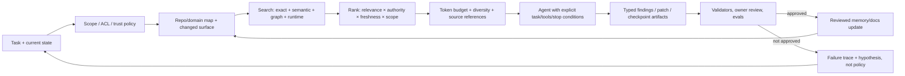
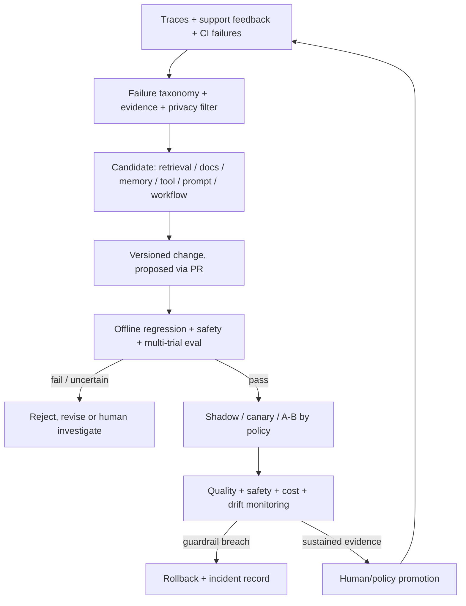

# Управление контекстом многоагентных систем

> [!abstract] Коротко
> Контекст — не просто prompt и не вся история чата. Это отобранное для конкретного шага
> состояние задачи: инструкции, код/данные, история, инструменты, результаты поиска, память,
> ограничения доступа и результаты предыдущих шагов. Цель — доставить **минимальный достаточный,
> актуальный, разрешённый и проверяемый** пакет каждому агенту, сохраняя полную историю вне окна.

## Принципы

1. **Write, select, compress, isolate**: записывать полезное во внешние артефакты, выбирать по задаче,
   сжимать только с проверкой, изолировать контекст между агентами и tenants.
2. **Map, not manual**: короткий стабильный индекс с путями/командами и progressive disclosure;
   длинные детали загружать только по надобности.
3. **Источники важнее пересказа**: хранить ссылки на commit/path/issue/test/trace и происхождение;
   summaries — производные представления с provenance, не замена источника истины.
4. **Скоуп + свежесть + права** входят в retrieval. Семантическая релевантность без ACL, актуальности
   и уровня доверия опасна.
5. **Разделяйте факты, гипотезы, решения и инструкции**. Вывод из кода не равен согласованному intent.
6. **Один worker — одна цель и минимальный пакет**. Координатор передаёт handoff через типизированный
   task/artifact, а не копирует все внутренние рассуждения и логи.
7. **Память не самоутверждается**: агент может предложить learnings; правила/политики меняются через
   review и eval, а персональные факты имеют owner, границы доступа, исправление/удаление.
8. **Оценивать качество, не только tokens**: correctness, retrieval recall/precision, task success,
   privacy/safety, latency, cost, context staleness и human review burden.

## Модель контекста: разные слои — разные жизненные циклы

| Слой | Примеры | Scope/TTL | Источник/обновление |
|---|---|---|---|
| Конституция / policy | Допустимые действия, правила безопасности, merge/deploy gates | Версионируется, действует до reviewed change | Git + protected policy/CI; не агентская память |
| Repo map | Модули, owners, команды, indexes, архитектурные ссылки | На репозиторий, пересобирается по commit | Генераторы + владельцы; короткий индекс |
| Domain context | Контракты, ADR, business semantics, threat model | Модуль/сервис/домен; review/expiry | Reviewed docs/schema/contracts |
| Task context | Issue, acceptance criteria, changed paths, plan, scope, stop rules | Один task / workflow run | Issue + immutable task snapshot |
| Working state | Текущий план, todo, решения, unresolved assumptions | Одна сессия/задача, checkpointed | Typed workflow state / scratchpad |
| Episodic memory | Что делал агент, что сработало/не сработало, traces | Scoped task/session; хранить по policy | Event log; выборочно искать, не prompt dump |
| Semantic/project memory | Подтверждённые факты, непредвиденные edge cases, локальные conventions | Repo/project scope, version/owner/expiry | Proposed → reviewed → active; source links |
| User/team preferences | Формат ответа, coding style preferences | User/team scoped; consent/control | Editable/deletable memory with access checks |
| Tool/context data | Search results, DB rows, profiler output, tool schemas | Request/step-scoped; cache TTL | Just-in-time fetch; redact and bound output |
| Handoff artifact | Findings, citations, patch summary, test evidence | Между конкретными workflow nodes | Typed schema + file/URI + version/digest |

**Не смешивать:** short-term state/checkpoint обеспечивает продолжение одного run/thread; long-term
memory — выборочные сведения между задачами; repo docs — утверждённые знания команды; policy —
исполняемые ограничения. Бесконечный chat transcript — ни одна из этих вещей.

## Контекстный конвейер на каждый вызов модели



Практический порядок:

1. Составить task contract: цель, недопустимые изменения, критерий успеха, риск, разрешения.
2. Загрузить неизменный короткий слой: конституция, точные команды проверки, task contract.
3. Найти изменённые symbols/paths/owners/callers/contracts и подходящие tests; не индексировать заново
   весь мир, если задача локальна.
4. Из retrieval выдавать ранжированные фрагменты с provenance: репозиторий, commit, path/line,
   author/owner, дата/версия, access label, confidence.
5. Выделить бюджет для ответа и инструментов; дать ссылку/файл на большие артефакты, не вставлять целиком.
6. На tool outputs применять схемы, pagination, filtering, limits; выводы и логи могут включать prompt injection.
7. После шага писать важные факты в external state; перед новым context window перечитывать проверенные
   handoff artifacts, а не полагаться на auto-summary.

### Формат краткого handoff

```yaml
run_id: change-1842
commit: 0123456789abcdef
objective: Fix duplicate retries without changing public API
scope: [services/retry/**, tests/retry/**]
constraints: [no schema migration, no production calls]
known_facts:
  - claim: retry key is tenant-scoped
    source: src/retry/key.ts#L18-L37@0123456
    status: verified
open_questions: ["Do delayed retries share same idempotency key?"]
findings: [artifacts/audit-security.json, artifacts/audit-logic.json]
plan_next: implement one fix and add regression test
verify: ["pnpm test --filter retry", "pnpm lint", required CI]
stop_if: ["public contract must change", "test oracle unclear", "high risk finding"]
```

Handoff должен быть исполнимым, достаточно коротким, содержать unresolved items и ссылки на evidence.
Не требовать agent-to-agent передачи полного chain-of-thought; передавать conclusions/evidence/uncertainty,
а системную трассу хранить вне context с соответствующим доступом и retention.

## Практики для multi-agent схем

### Декомпозиция и context isolation

- Делегировать независимые поиски (архитектура, security, tests, performance, repo history) с read-only
  permissions и ограниченным path/scope.
- Для каждой роли фиксировать: точный вопрос, разрешённые источники/tools, required output schema,
  budget, stop rule и запрет на overlap с write-agent.
- Coordinator посылает worker-у общий task contract + минимальный domain map + собственный subtask.
  Worker возвращает findings с цитируемыми evidence и неизвестными; coordinator не пересказывает сырые логи.
- Общие большие артефакты — файл/объект с ID и digest; сообщения передают ссылку. Не использовать
  общий mutable scratchpad без владельца, schema и locking/versioning.
- Разделять контексты по репозиторию, task, user/tenant и trust boundary. Retrieval обязан применять ACL
  до generation; поздний prompt «не раскрывай приватное» не является authorization.
- Разрешать свободный cross-agent context только при необходимости: tightly coupled pair может делить
  общий immutable brief, но не весь диалог/credentials.
- Если work/tasks сильно связаны (много общих файлов, зависимые решения), один agent с богатым контекстом
  или serial workflow обычно проще; multi-agent создаёт стоимость координации и diff conflict.

### Топологии и подходящие задачи

| Паттерн | Контекст | Хорошо подходит | Риск |
|---|---|---|---|
| Router → specialist | Router держит map, worker — subtask | Поиск по известным доменам | Плохой routing скрывает relevant branch |
| Parallel sectioning | Независимые worker contexts, агрегатор видит summaries | Breadth-first audit, поиск в нескольких repos | Дубликаты, потерянные caveats, стоимость |
| Orchestrator + artifact store | Worker сохраняет report/artifact, coordinator получает ссылки | Большие результаты, долгие jobs | Stale artifact / ACL / schema mismatch |
| Shared state graph | Typed fields, checkpoint за node/step | Durable workflows и recovery | Скрытые writes/races и размытый ownership |
| Sequential handoff | Узкий artifact передаётся следующему агенту | Research → plan → implement → verify | Потеря контекста при плохом handoff |
| Debate / independent review | Reviewer не получает имплементационное убеждение | High-risk review и альтернативы | Несколько LLM не равны независимой истине |

**Не считать масштабирование числом агентов.** Параллелить работы, чьи результаты действительно можно
сливать: независимые read-only исследования — хороший кандидат; concurrent edits на API, миграции или
одних файлах — плохой.

## Memory: что записывать, как искать, как забывать

### Candidate memory schema

```json
{
  "id": "repo:payments:retry-idempotency",
  "scope": {"org": "example", "repo": "payments", "module": "retry"},
  "kind": "fact | episode | preference | procedure | decision",
  "claim": "Retry keys include tenant scope; never reuse across tenants",
  "source": [{"uri": "git://payments/src/retry/key.ts", "commit": "0123456"}],
  "confidence": "verified | reviewed | observed | hypothesis",
  "valid_from": "2026-11-21",
  "expires_at": null,
  "supersedes": null,
  "owner": "payments-team",
  "access": "repo-members",
  "proposed_by": "agent-run-1842",
  "approved_by": "code-owner",
  "status": "active"
}
```

- **Не хранить всё:** извлекать новые memory candidates из corrections, repeated reviews, test failures,
  non-obvious successful discoveries. Выбирать по будущей полезности и вероятности повторного применения.
- **Память атомарна:** один claim/condition per record, с контекстом применения; distinguish “always” from
  “for service X / before date Y”.
- **Обновлять, не накапливать конфликты:** memory write step ищет возможные дубликаты/опровержения,
  делает versioned patch и ставит contested cases на human review.
- **Freshness:** кодовые факты привязаны к commit/schema; operational facts имеют TTL; старые записи
  revalidate on fetch или исключить. Не использовать recency как единственный proxy for truth.
- **Provenance:** каждое утверждение ссылается на Git commit, reviewed ADR, ticket или trace, сохраняет
  status (hypothesis/observed/verified/approved) и автора.
- **Privacy/retention:** user-level namespace; PII минимизировать, retention/consent/delete поддерживать;
  secrets и credential material не сохранять вообще.
- **Memory poisoning:** тексты из issues, PR, tool results считаются untrusted; не превращать их в
  project instruction без approval. Проверять источник и privilege, особенно memory search results.
- **Удаление/суперсессия:** иметь API для inspect/edit/forget, retention job и explicit supersedes;
  векторный индекс/кэш также должен очищаться по идентификатору.

## Сжатие и длинные задачи

| Механизм | Применение | Сохранить обязательно | Проверить |
|---|---|---|---|
| Sliding window | Short conversational history | System/task contract + recent interactions + required state | Does old important fact still retrieve? |
| Summary/compaction | Token budget nearing cap | Objective, decisions + rationale, facts/provenance, open issues, tests, stop rules | Compare against source artifacts / required field assertions |
| Structured notes | Long-running project tasks | Plan, progress, blockers, decisions, exact next step | Resume a fresh session from notes only |
| External transcript/event log | Audit/debug/recovery | Tool events, version IDs, artifacts; privacy-safe | Replay/resume from checkpoint |
| Subagent handoff | Parallel research | Task-specific answer with citations, uncertainty, no unnecessary raw trace | Schema validation, completeness checks |
| Tool-output summarization | Large logs/search/DB results | Relevant evidence slices and counts/filters | Keep raw artifact reference for verification |

Summary is lossy: preserve high-risk constraints and structured facts verbatim; retain pointers to original
messages/results for retrieval. Periodically test “cold resume”: a fresh agent can continue correctly from
stored state, without access to previous live context. Context reset is often better than endless transcript
accumulation after task boundary, unrelated request, or topic shift.

## Git as context and memory system of record

Git is useful because it gives versioning, review, blame, rollback, branches and CI to project knowledge.
It does **not** automatically make knowledge true, discoverable, safe, or current.

- Keep root agent instructions as brief navigation + universal do/don't + exact test commands; deeper
  instructions scoped in `AGENTS.md`, `CLAUDE.md`/IDE-specific rules or skills close to owning module.
- Avoid duplicating canonical requirements across several agent formats. Choose a canonical source and
  generate client-specific artifacts where needed; CI checks generated files are in sync.
- Version maps, ADRs, architecture/contracts, task plans, schemas, eval datasets/rubrics and memory
  promotion changes. Include source links and owner/review trigger.
- Keep ephemeral per-run notes, full traces, secrets, embeddings/vector DB data out of Git. Store in
  secured external stores with commit/run references.
- A candidate learning can be a draft PR with evidence, not a direct edit of protected instructions.
  Review policy/skills/tests as production code; run regression eval suite before merge.
- Use path ownership and code review to approve team-level memory; avoid automatically pushing every
  agent note to shared memory.

### Git-based cases and projects (illustrative, not performance guarantees)

| Case / repository | Useful pattern | How to reuse / caveat |
|---|---|---|
| OpenAI Harness Engineering (case study; source public article) | `AGENTS.md` as index, repo-local docs/design/quality maps, plans, executable architecture rules, doc-gardening PRs | Greenfield + first-party case; adapt the repo-knowledge system, not its throughput/ROI claims |
| `openai/symphony` (GitHub) | Issue-driven orchestration, per-issue workspace, repo-owned `WORKFLOW.md`, bounded concurrency, retries and structured logs | Repository labels implementation as prototype/evaluation software; use as design study, not hardened production dependency |
| `langchain-ai/context_engineering` (GitHub) | Four notebooks: write, select, compress, isolate; code examples for LangGraph | Educational notebooks; compare against your own data, version pins and evals |
| `langchain-ai/langgraph-memory` (GitHub) | Persistent, scoped memory service and memory eval tests | Example architecture; validate the actual access, retention and update policies for your deployment |
| GitHub Copilot Memory / GitHub Intelligence (first-party product case) | Personal/repo memory, cross-repo search, curated updates; repository changes can be proposed for review | Product/vendor example; reported preview percentages are platform-specific, not expected lift for another team |
| GitHub Agentic Workflows (first-party repo automation example) | Read-only-by-default and explicit safe outputs for write operations | Good least-privilege pattern; check current preview/status, threat model and workflow permissions |

## Testing context engineering

### Eval dataset

Создать versioned suite на реальные representative tasks, а не только happy-path. Для coding/workflow:

- Relevant files / symbols should be retrieved (including cross-repo callers, generated code and contracts).
- Relevant instructions are followed; irrelevant/stale instruction does not dominate.
- Multi-agent handoff preserves all required facts, scope, uncertainty, source references and stop rules.
- Retrieval does not cross user/repo ACL or trust boundaries; prompt injection from issue/log/docs is inert.
- Correct memory is used, conflicting/outdated memory rejected or clarified; user can edit/forget.
- Compaction/resume preserves decisions, requirements, test commands, unresolved items; no invented “facts”.
- Context budget, tool schemas and result truncation fail visibly rather than silently dropping required facts.
- Performance/price: tokens, tool calls, latency, retrieval p95, model calls, repeat success rate.

### Graders: use a portfolio

1. **Deterministic**: required phrases/IDs/source citations, schema validity, ACL, file paths, forbidden actions,
   compile/tests, outcome-state assertions. Strong for objective invariants.
2. **Reference/coverage**: known relevant files/evidence retrieved; recall@k, precision@k, MRR/nDCG; check
   citation source validity and version.
3. **LLM rubric / pairwise**: relevance, completeness, faithfulness, handoff usefulness, instruction following;
   calibrate against blinded human labels, monitor judge drift and position bias.
4. **Human review**: ambiguous correctness, memory utility, risk, product intent, privacy. Sample both wins
   and regressions; adjudicate judge disagreement.
5. **End-state**: did the resulting workspace/DB/PR satisfy the task? Multi-step agent transcript alone is
   insufficient; conversation claims do not prove an action occurred.
6. **Security tests**: adversarial retrieval/query, cross-tenant leakage, prompt injection, tool overreach,
   memory poisoning, deletion/retention. Run on controlled fixtures and staging only.

Run multiple trials for nondeterministic agent tasks; report success rate and uncertainty, not one run.
Keep eval environment isolated/clean; pin model, prompt, tools, retrieval snapshot, seeds when possible,
benchmark dataset version, and record commit + configuration. Inspect traces of wins and failures, not just
aggregate judge score. Create a new regression example from confirmed production failures after redaction.

### A/B and controlled rollout

Use A/B for changes whose online behavior depends on real distribution or user preference (retrieval ranker,
context template, memory use policy, context budgets). It does **not** replace offline eval or safety gates.

1. Before experiment, define hypothesis, primary metric, guardrail metrics, target population, unit of
   randomization, expected duration, sample-size/power and stopping plan.
2. Compare same agent/model/tools with one deliberate context variable changed; pin variant IDs and log
   actual context source/version, retrieved IDs, tokens, ACL/filter outcomes. Avoid multiple simultaneous
   changes that prevent attribution.
3. Randomize at stable unit (user/team/task) to avoid same user receiving inconsistent memory policies;
   consider cluster effects and contamination when agents share repo/team memory.
4. Primary metric: task success/correctness or blinded pairwise preference. Guardrails: privacy/safety,
   hallucination/unsupported claims, regressions by segment, tool failure, latency/cost, abandonment,
   review burden. A cost improvement cannot trade off policy correctness.
5. For subjective outcomes, use blinded pairwise human eval with rubric; for objective tasks, state-based
   checks. Use pre-registered sample size and minimum detectable effect; don't stop on a favorable early peek.
6. Start with offline replay → shadow/dry-run → small canary → randomized test → staged rollout. Stop/rollback
   on pre-defined safety or service guardrails; retain a control cohort if drift matters.
7. Analyze by risk/domain and confidence intervals; an average lift may mask a harmed subgroup or rare severe
   failure. Publish negative/no-effect results too.

A/B is inappropriate for exposing users to unsafe alternatives, insufficient traffic, major distribution
mismatch, or shared-memory variants that contaminate one another. Use offline paired experiments or
shadow evaluation instead. Feature flags and audit logs should control rollout, not model judgment.

## Adaptive improvement without uncontrolled self-modification



Adaptive loop:

1. Observe a failure or repeated correction; classify whether the cause is missing source knowledge, bad
   retrieval, stale memory, oversized context, tool schema, model behavior, orchestration, or bad test.
2. Keep trace and context snapshot with sensitive data redacted and source/version provenance.
3. Propose the *smallest* change: index/map, retrieval filter/ranker, context builder, memory candidate,
   tool output format or workflow node. Do not immediately add a universal instruction.
4. Turn confirmed failure into eval test; use a holdout/representative suite to detect overfit.
5. Submit change to Git review; protect eval graders, ACL policy and release gates from the same agent's write
   scope. Store `why`, source evidence, owner, rollout and expiry/review condition.
6. Run offline regression + security tests; staged rollout/canary with rollback. Promote only evidence-backed
   changes. Track reversals and harmful memories.
7. Periodically garbage-collect unused, duplicated, stale or low-quality context and review retrieval logs.

**Self-improvement boundary:** agent may inspect traces, propose or draft changes, generate candidate
memories and tests. It must not silently rewrite its own system policy, permission model, eval oracle,
protected instructions or deployment thresholds, nor certify its own update. Agent-generated rules are
hypotheses until human/owner approval and CI verification.

## Tools and implementation choices

| Need | Options / examples | Selection note |
|---|---|---|
| Orchestration + scoped state | LangGraph (state graph, checkpoint + store); OpenAI Agents SDK/Responses; Temporal for durable workflow control | Separate orchestration durability from model context; avoid ambient shared state |
| Context patterns / examples | `langchain-ai/context_engineering` notebooks; Anthropic context engineering article | Learn write/select/compress/isolate, then implement only relevant primitives |
| Repo knowledge | Git, Markdown/ADR, CODEOWNERS, LSP, ripgrep, AST/index/graph, GitHub code search | Generated maps for structure; human-reviewed intent and ownership |
| Retrieval | BM25 + lexical/code search + embeddings/reranker; metadata/ACL filters | Hybrid retrieval and code graph; benchmark against lexical baseline |
| Memory | LangGraph Store/Memory Service; Postgres/SQLite + FTS/vector as needed; mem0 as one candidate | Choose based on update, delete, provenance, tenancy and operational requirements, not feature list |
| Prompt/context tests | Promptfoo evals, pytest/jest custom graders, LangSmith datasets/experiments | Commit dataset/config; CI-friendly offline evals and security red-team |
| Tracing/eval analysis | OpenTelemetry GenAI spans, LangSmith, Langfuse, Arize Phoenix, Braintrust | Record sources and budgets without retaining sensitive content unnecessarily |
| Git automation | GitHub Actions, GitHub Agentic Workflows, OpenAI Symphony (prototype) | Least privilege, ephemeral workspaces, safe outputs, explicit approval for write operations |
| A/B/flags | Existing feature flag system + experiment platform; pairwise queues/eval platform | Preserve randomized assignment, variant lineage and rollback |

**Tooling rule:** start with small self-hostable or existing stack. Choose one trace standard, one canonical
context record format, and a few eval surfaces. Adding vector DB/agent framework is not inherently context
engineering; quality comes from correct contracts, retrieval, state lifecycle, ACL, tests and operations.

## Rollout checklist

- [ ] Context sources inventoried with owner, freshness, permissions, source-of-truth and deletion policy
- [ ] Separate policy, repository docs, task state, episodic log and long-term memory
- [ ] Exact search/AST/code graph exists before relying on vector retrieval for code
- [ ] Retrieval applies ACL and scope filters before context reaches a model/tool
- [ ] Every selected fragment has source/version/confidence and refresh policy
- [ ] Context budgets are measured per node/role; summaries preserve required facts and evidence pointers
- [ ] Multi-agent tasks are independent; handoffs are typed/versioned; write scopes isolated
- [ ] Shared memory changes are proposed/reviewed; agent cannot edit its own protected oracle
- [ ] Offline multi-turn suite includes cold resume, stale/contradictory memory and prompt injection
- [ ] Eval runs include multiple trials, traces, human calibration and realistic state outcomes
- [ ] A/B design has randomization unit, sample-size plan, safety guardrails, variant logging and rollback
- [ ] Production feedback enters privacy-filtered triage and creates versioned tests before policy updates
- [ ] Context stale/unused/duplicated items have cleanup jobs and owners

## Связи

- [[Архитектура агентной software factory]] · [[Код, контекст и минимальный harness]] · [[Harness-инжиниринг]] · [[Большие кодовые базы]] · [[Навигация по коду]] · [[Параллельная работа агентов]] · [[Контракт задачи для агента]] · [[Evals и метрики агентной разработки]] · [[Threat model агентной разработки]] · [[Безопасность MCP и инструментов]] · [[Агентский CI-CD]] · [[Операционная модель агентных команд]]

## Источники

- Anthropic, *Effective context engineering for AI agents* (context retrieval, compaction, notes, subagents): https://www.anthropic.com/research/effective-context-engineering-for-ai-agents
- Anthropic, *How we built our multi-agent research system* (parallel exploration, artifact handoffs, cost and limits): https://www.anthropic.com/engineering/multi-agent-research-system
- Anthropic, *Demystifying evals for AI agents* (trials, graders, end-state, offline+online+human+A/B): https://www.anthropic.com/research/demystifying-evals-for-ai-agents
- Anthropic, *Effective harnesses for long-running agents* (initializer/coding agent and durable artifacts): https://www.anthropic.com/engineering/effective-harnesses-for-long-running-agents
- OpenAI, *Harness engineering* (Git repository as knowledge system, map not manual, verified docs/architecture, case-study caveat): https://openai.com/index/harness-engineering/
- OpenAI, *Inside our in-house data agent* (code-enriched context, permissions-aware organizational knowledge, user-curated memory, runtime retrieval; first-party internal case): https://openai.com/index/inside-our-in-house-data-agent/
- GitHub, *GitHub intelligence* (repo memory, cross-repo search, opt-in dreaming; product case, not independent efficacy benchmark): https://github.blog/changelog/2026-10-28-github-intelligence-puts-your-code-context-and-history-to-work/
- GitHub repo: `openai/symphony` (issue orchestration, workflow context, isolated workspaces; implementation states prototype/evaluation): https://github.com/openai/symphony
- GitHub repo: `langchain-ai/context_engineering` (write/select/compress/isolate notebooks): https://github.com/langchain-ai/context_engineering
- GitHub repo: `langchain-ai/langgraph-memory` (memory service/eval example): https://github.com/langchain-ai/langgraph-memory
- LangGraph docs, memory/persistence: https://docs.langchain.com/oss/python/langgraph/memory and https://docs.langchain.com/oss/python/langgraph/persistence
- LangSmith docs, evaluation concepts and comparison: https://docs.langchain.com/langsmith/evaluation-concepts
- Promptfoo docs, eval + red-team CI workflows: https://www.promptfoo.dev/docs/integrations/ci-cd/

> [!warning] Как читать vendor кейсы
> Архитектурные паттерны могут быть полезны как примеры; self-reported throughput, lift и проценты
> memory uplift не переносить на свой продукт. Проверять на собственных задачах, сегментах и safety gates.
