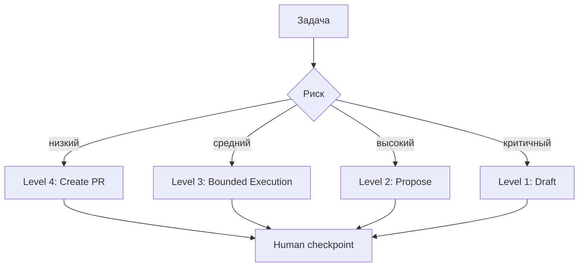

# Уровни автономии

> [!info] Определение
> Task-Level Autonomy Framework: 6 уровней от Suggest до Autonomous Merge.
> Уровень выбирается по типу задачи и риску, а не по желанию.
> См. [[Сквозной цикл разработки]], [[Агентский CI-CD]].

## Уровни 0–5

| Level | Label | Что может AI | Человек |
|---|---|---|---|
| 0 | Suggest | Только советы, без правок | Читает, решает сам |
| 1 | Draft Artifacts | Черновики текста/кода/планов | Ревьюит, применяет вручную |
| 2 | Propose Changes | Diff + test plan | Ревьюит, approves/rejects |
| 3 | Bounded Execution | Команды в sandbox с границами | Мониторит, rollback authority |
| 4 | Create PR/MR | Открывает PR, не мержит | Ревьюит PR, merge authority |
| 5 | Autonomous Merge/Deploy | Мержит и деплоит | Oversight; не рекомендуется большинству |

## Decision framework

| Задача | Уровень | Почему |
|---|---|---|
| Exploratory review | 0 | Контекст, не действия |
| Test generation | 1–2 | Высокий объём; валидация человеком |
| Security analysis | 1–2 | Высокие ставки |
| Documentation | 2 | Структурированный вывод |
| Dependency update | 4 | Чёткий outcome; merge у человека |
| Pipeline test execution | 3 | Изолированная среда |
| Production deployment | 4 at most | Human authorization обязателен |
| Multi-agent workflow | 3–4 с gates | План ревьюится, outcome approves |

## Workflow modes

| Use case | Mode | Уровни | Эскалация |
|---|---|---|---|
| IDE code completion | Synchronous | 0–2 | Auth/encryption/mission-critical |
| CI test generation | Asynchronous | 2–3 | Coverage claims не верифицируемы |
| Nightly security scan | Asynchronous | 1–2 | Critical/high findings |
| Dependency PRs | Asynchronous | 4 | Security library / license conflict |
| Multi-agent sprint | Asynchronous | 3–4 | Любой agent flag / отклонение от плана |

## Диаграмма

## Мнемоника

**«Совет, Черновик, Предложение, Границы, PR, Автономность»** — СЧПГПА.

## Связи

- [[Сквозной цикл разработки]] · [[Агентский CI-CD]] · [[Аудит кода]] · [[Безопасность]]

## Типичные ошибки

> [!warning]
> Level 5 без formal governance: не рекомендуется. Автономность без rollback
> conditions: Level 3 требует границ до исполнения. Production deployment без
> human authorization: нарушение framework.
