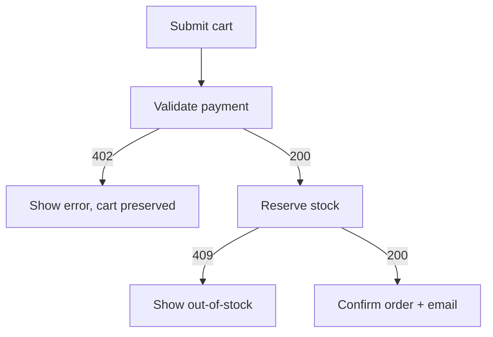
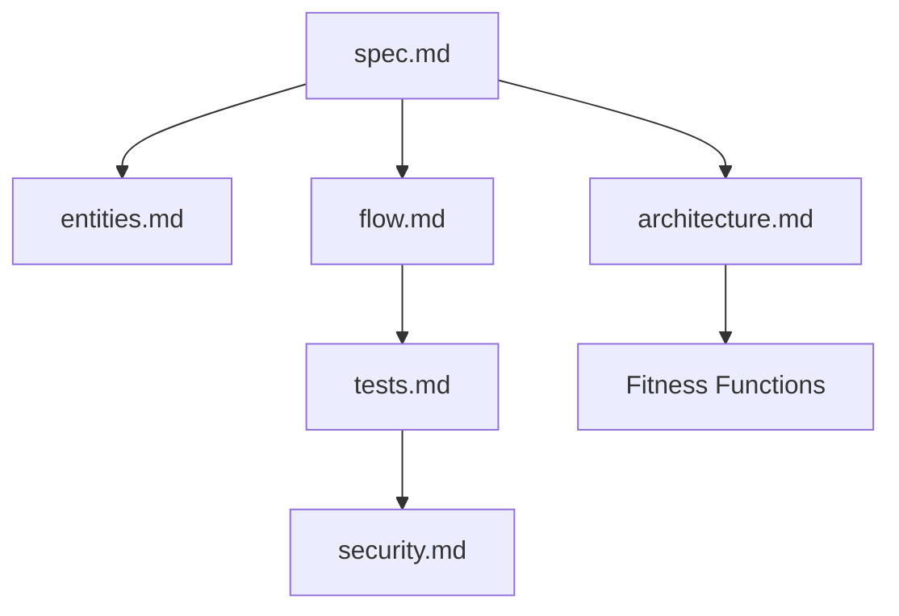

# Пример: пакет документации фичи

> [!info] Определение
> Полный машиночитаемый пакет документации фичи: spec, сущности, флоу, тесты,
> безопасность, архитектура. См. [[Тесты]], [[Сущности]], [[Флоу]], [[Безопасность]],
> [[Аудит архитектуры]], [[Следование архитектуре]]. Минимальный проектный пакет и условия для отдельных spec/plan/ADR см. в [[Исследование формата документации проекта и входящей задачи]].

## Структура пакета

```
docs/features/order-checkout/
├── spec.md              ← objective, contracts, boundaries, Not Included
├── entities.md          ← Order, Payment, Inventory: attributes, invariants, lifecycle
├── flow.md              ← шаги, error paths, state machine (Mermaid)
├── tests.md             ← acceptance criteria (observable/atomic/bounded), test plan
├── security.md          ← threat model, gates, audit trail
└── architecture.md      ← fitness functions, reuse decisions, ADR links
```

## spec.md

```markdown
# Spec: Order Checkout

## Objective
Customer completes checkout in one page without leaving the flow.

## Contracts
- POST /orders → 201 {order_id} (OpenAPI: openapi.yaml#/paths/~1orders)
- Payment: 200 | 402; Inventory: 200 | 409

## Boundaries
- Always: validate input, reserve stock before payment
- Ask first: new payment provider, schema changes
- Never: charge without reservation; store card data

## Not Included
- Refunds (separate feature)
- Multi-currency (phase 2)
```

## entities.md (фрагмент)

```markdown
# Order

Attributes: id, customer_id, status, total, items[]
Invariants: total = sum(items.price); status transitions only forward
Lifecycle: cart → payment_pending → confirmed | failed
Relationships: belongs-to Customer; has-many OrderItem
```

## flow.md (фрагмент)



## tests.md (фрагмент)

```markdown
## Acceptance criteria
- Given valid cart, POST /orders returns 201 with order_id
- Given payment decline, POST /orders returns 402, cart unchanged
- Given out-of-stock, POST /orders returns 409, no charge

## Test plan
- pnpm test -- --runInBand
- Coverage target: 90% on src/orders/**
```

## security.md (фрагмент)

```markdown
## Threats
- Prompt injection via product names → sanitize input
- Card data leakage → never log; vault only

## Gates
- SAST + secret scan in CI (blocking)
- Human approval for payment provider changes
```

## architecture.md (фрагмент)

```markdown
## Fitness functions
- orders/ must not import billing/ directly (via events)
- No cycles: orders ↔ inventory

## Reuse
- USE_EXISTING: PaymentGateway (src/payments/gateway.ts)
- KEEP_LOCAL: checkout-specific pricing rules
```

## Диаграмма



## Мнемоника

**«Спецификация, Сущности, Флоу, Тесты, Безопасность, Архитектура»** — ССФТБА.

## Связи

- [[Тесты]] · [[Сущности]] · [[Флоу]] · [[Безопасность]] · [[Аудит архитектуры]] · [[Следование архитектуре]] · [[Чек-листы]]

## Типичные ошибки

> [!warning]
> Пакет без Not Included: агент строит соседние фичи. Тесты без observable criteria:
> агент угадывает. Архитектура без fitness functions: только надежда на ревью.
