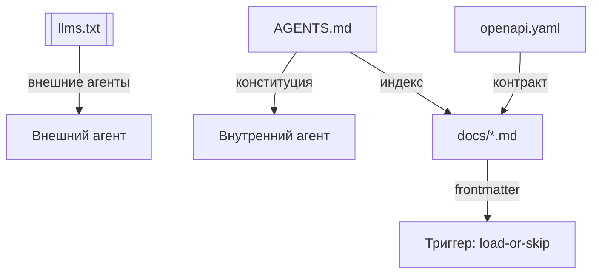

# Пример: структура docs для большого проекта

> [!info] Определение
> Сквозной пример машиночитаемой документации: llms.txt + AGENTS.md Index +
> frontmatter + Codified Context. См. [[Codified Context (3 яруса)]],
> [[AGENTS.md Index]], [[llms.txt]].

## Структура репозитория

```
project/
├── llms.txt                       ← индекс для внешних агентов
├── AGENTS.md                      ← конституция + lazy-load индекс
├── frontend/
│   └── AGENTS.md                  ← React conventions
├── backend/
│   └── AGENTS.md                  ← REST conventions
├── docs/
│   ├── auth.md                    ← frontmatter: триггер, paths, tags
│   ├── billing.md
│   └── architecture/
│       ├── context.md             ← C4: context view (Mermaid)
│       └── container.md           ← C4: container view
├── .agents/docs/
│   ├── INDEX.md                   ← темы с датами свежести
│   └── gemini-cli/
│       └── DOC.md                 ← navigation map + сниппеты
└── openapi.yaml                   ← контракт API
```

## AGENTS.md (конституция + индекс)

```markdown
# AGENTS.md

## Constitution

- Build: pnpm build
- Test: pnpm test
- Errors: Result-паттерн (src/utils/result.ts)
- Never: direct DB queries in route handlers

## Docs index

| Doc | Load when | Paths | Status |
|---|---|---|---|
| [Auth flow](docs/auth.md) | changing login, sessions, tokens | src/auth/** | fresh |
| [Billing](docs/billing.md) | touching payments, invoices | src/billing/** | stale |
```

## docs/auth.md (frontmatter + структура)

```yaml
---
title: Authentication flow
description: Load when changing login, sessions, tokens, or OAuth callbacks.
paths: [src/auth/**, src/middleware/session.*]
tags: [auth, security]
lastValidated: 2026-10-01
maxAgeDays: 90
---

## Authentication flow

- Service: `src/auth/gateway.ts`
- Provider: Identity Provider (OAuth 2.0)
- Token cache: Redis, TTL 300s
- Failure: provider timeout → retry with backoff (max 3)
```

## Диаграмма



## Мнемоника

**«Индекс, Конституция, Триггеры, Контракты»** — ИКТК.

## Связи

- [[Codified Context (3 яруса)]] · [[AGENTS.md Index]] · [[llms.txt]] · [[Frontmatter-схемы]] · [[Чек-листы]]

## Типичные ошибки

> [!warning]
> Детали в AGENTS.md вместо docs/: налог каждую сессию. Индекс вручную: дрейф.
> Нет frontmatter: агент не может решить load-or-skip.
