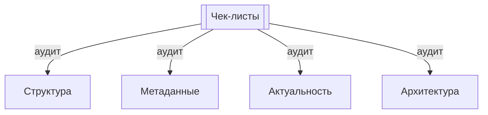

# Чек-листы: аудит машиночитаемой документации

> [!info] Определение
> Контрольные списки качества: структура, метаданные, актуальность, CI.
> См. [[AI-Native Documentation]], [[AI-Readiness scoring]].

## Чек-лист структуры

- [ ] Иерархии H1→H2→H3 консистентны
- [ ] Атомарные единицы: факт без окружающего контекста
- [ ] Связи явные (не выводимые из структуры)
- [ ] Конкретные пути, имена, параметры
- [ ] Диаграммы Mermaid с реальными именами узлов

## Чек-лист метаданных

- [ ] Frontmatter на каждом документе (title, description, paths, tags)
- [ ] Description — триггер-условие, а не пересказ
- [ ] lastValidated + maxAgeDays заданы
- [ ] Индекс генерируется (не вручную)
- [ ] llms.txt в корне (для внешних агентов)

## Чек-лист актуальности

- [ ] Staleness-пороги per doc
- [ ] Smart refresh по upstream_commit/changelog
- [ ] Link-rot scan в CI
- [ ] Документация против схем: drift-check в CI
- [ ] AI-Readiness score измеряется регулярно

## Чек-лист больших кодовых баз

- [ ] Иерархия context-файлов: home → root → subdirectory
- [ ] Lazy loading: child-файлы только в своей директории
- [ ] Token budget per context file как quality gate
- [ ] WHAT/HOW/WHY/FEEDBACK структура
- [ ] Нет анти-паттернов: acronyms, ambiguity, stale, overload
- [ ] Subdirectory scoping: сессии внутри модулей, не в корне

## Чек-лист навигации по коду

- [ ] Agentic search (grep + AST) вместо stale vector RAG
- [ ] LSP: символы, references, type info
- [ ] REPOSITORY_MAP.md + per-module CONTEXT.md (~60 строк)
- [ ] Two-layer index: structural + semantic
- [ ] Generated graph для машинных фактов (cycles, impact)

## Чек-лист аудита кода

- [ ] Гейты blocking: secrets, SAST, SCA, IaC, Unicode, changed-path
- [ ] Глубина ревью по риску (auth/crypto/payments — AppSec)
- [ ] Multi-bot chains для high-stakes изменений
- [ ] Provenance: AI labels, commit signing, agent identities
- [ ] Audit checklist: TruffleHog, Semgrep, Snyk, ZAP, deserialization
- [ ] AI review никогда не удовлетворяет approval rules

## Чек-лист сквозного цикла

- [ ] Цикл: Intent→Plan→Build→Verify→Secure→Deploy→Observe→Improve
- [ ] Фаза внедрения: assisted → coordinated → governed → adaptive
- [ ] Стек: orchestration, sandbox, context store, policy engine, observability
- [ ] Human approval workflow с реальными полномочиями
- [ ] Governance до autonomy; старт с low-risk workflow

## Чек-лист уровней автономии

- [ ] Уровень по риску задачи (0–5), не по желанию
- [ ] Level 3: sandbox + rollback conditions до исполнения
- [ ] Production deployment: human authorization обязателен
- [ ] Эскалация при отклонении от плана

## Чек-лист агентского CI/CD

- [ ] Self-healing: классификация, transient routing, fix + re-run
- [ ] Tiered autonomy: low/medium/high tiers
- [ ] Decision trace в PR comments
- [ ] Governance с начала: audit trails, policy, confidence gating
- [ ] Incident memory: outcomes обратно в память

## Чек-лист минимального harness

- [ ] Для задачи достаточно текущего кода/search/tests или нужен отдельный intent/policy artifact?
- [ ] Always-on контекст минимален; детали on-demand по карте/пути
- [ ] Objective и critical invariants — в коде/tools/policy/CI, не только prose
- [ ] Мягкие правила не превращены в обязательные hard gates без причины
- [ ] Инструкции актуальны, не противоречат коду и имеют owner/review trigger
- [ ] Эффект каждого крупного context/harness слоя проверяется локальными evals
- [ ] Польза перевешивает токены, latency, maintenance и constraint side effects
- [ ] Неиспользуемые/дублирующие/устаревшие артефакты удаляются

## Чек-лист harness-инжиниринга

- [ ] 6 модулей: providers, memory, skills, sandbox, permissions, LSP
- [ ] Evals в 3 стадии: benchmark → regression → production
- [ ] Sandbox на каждое исполнение (E2B/Docker/Modal)
- [ ] Observability: traces, cost, tool failures
- [ ] Harness версионируется; эволюция по evidence

## Чек-лист инструментов и безопасного деплоя

- [ ] Agent runtime отделён от sandbox; среда ephemeral per task
- [ ] Egress deny-by-default/allowlist; секреты short-lived и не попадают в контекст агента
- [ ] GitHub Actions: least privilege, pinned action SHA, OIDC для cloud
- [ ] Production environment: required reviewers, no self-review, branch restrictions
- [ ] CI повторяет проверки на чистом runner, независимо от агента
- [ ] Артефакт привязан к commit digest; provenance/SBOM проверяется
- [ ] Canary метрики, пороги, окно наблюдения и rollback заданы заранее
- [ ] Rollback проверен с учётом миграций и внешних side effects
- [ ] Trace связывает task → PR → commit → artifact → deployment; payload redaction настроен

## Чек-лист архитектуры

- [ ] Конституция <1500 токенов, стабильна
- [ ] Детали — в cold memory по триггеру
- [ ] Иерархия AGENTS.md по директориям
- [ ] Index-first: нет дампа репозитория
- [ ] Контракты (OpenAPI/JSON Schema) — источник правды

## Чек-лист многоагентной software factory

- [ ] Архитектурная карта привязана к проверяемому commit: modules, dependencies, contracts, owners, critical flows
- [ ] Baseline отделяет новые findings от принятого legacy debt; неуспешный/неполный scan = inconclusive
- [ ] Аудиторы read-only, scoped по доменам; findings имеют location, evidence, confidence, impact и repro
- [ ] Triage проверяет reachability/дубли/ложные срабатывания и направляет high-risk к владельцу
- [ ] Один bounded repair на isolated branch; allowlist путей и лимит итераций/стоимости
- [ ] Исполнитель не изменяет/ослабляет защищённые тесты, security rules, workflow и benchmark thresholds
- [ ] Есть regression test или другое наблюдаемое evidence для каждого исправленного дефекта
- [ ] Независимый verifier запускает affected tests, architecture/security scans и required CI
- [ ] Performance сравнивается с базой на фиксированном representative workload, повторно и с учётом шума
- [ ] Merge/release полномочия отделены; human approval задан для policy-defined high-impact изменений
- [ ] Логи связывают task → agent/tool versions → finding → patch → tests/scans → PR/commit
- [ ] Переход к большей автономии основан на локальных evals, false-positive rate, escaped defects и rollback readiness

## Чек-лист управления контекстом многоагентной системы

- [ ] Разделены policy, repo/domain context, task contract, working state, episodic trace и long-term memory
- [ ] Root instructions служат краткой картой; детали загружаются progressive disclosure по scope
- [ ] Retrieval учитывает ACL/tenant/repo, authority, freshness, source version и confidence
- [ ] Поиск сочетает exact/code/graph и semantic retrieval; vector search проверяется относительно baseline
- [ ] Сырые логи и крупные результаты остаются в артефактах с ссылкой/версией, не попадают целиком в каждый handoff
- [ ] Каждый subagent имеет минимальный scope, свои permissions, budget, stop rule и typed output contract
- [ ] Shared artifacts immutable/versioned или имеют явного owner/locking; контекст не течёт между tenants
- [ ] Compaction/summary сохраняет решения, причины, unresolved items, tests и source pointers; есть cold-resume eval
- [ ] Long-term memory атомарна, scoped, provenance-tagged, editable/deletable, с TTL/revalidation и supersession
- [ ] Агентские learning proposals не становятся policy автоматически; Git PR + offline regression + approval
- [ ] Offline eval содержит multi-turn, stale/conflicting context, retrieval misses, prompt injection и permission checks
- [ ] A/B меняет один существенный фактор; есть stable randomization unit, power/sample plan, segment metrics и safety stop
- [ ] Production traces redacted/minimized; подтверждённые failures превращаются в новые regression cases
- [ ] Мониторятся task success, retrieval quality, leakage, stale-memory rate, cost, latency и reviewer burden

## Чек-лист ТРИЗ и системных методов в разработке ПО

- [ ] Есть конкретный измеримый gap и подтверждённый baseline, а не только формулировка решения
- [ ] Заданы границы системы, функции, stakeholders, внешние зависимости и trust boundaries
- [ ] Отделены симптом, причина, verified fact и гипотеза; root cause проверяется evidence
- [ ] Противоречие сформулировано «если улучшаем A, ухудшается B» и подтверждён механизм
- [ ] Целевое состояние IFR конкретно и ограничено условиями, не «идеально всё»
- [ ] Проверены локальные ресурсы и несколько различных вариантов, не только 40-принципная аналогия
- [ ] Для software attributes не применяются механически физические параметры старой matrix
- [ ] Выбран минимально достаточный метод по типу неизвестного; ТРИЗ — набор инструментов, не одна техника: противоречия/разделение, function/resource analysis, Su-Field/standards, ARIZ, system operator/trends используются для разных целей
- [ ] Выбран аналог по domain question: Double Diamond для неясной user need; QAW → ADD → ATAM для architecture quality/tradeoffs; A3/PDCA для recurrence; DMAIC для process variation; TOC для подтверждённой очереди; FMEA/FTA/threat modeling для рисков; GMA для комбинаторного design space; SIT для TRIZ-derived ideation; TDD/property tests для доказательства
- [ ] Источник метода и уровень доказательств отделены от локального инженерного суждения; vendor claims/case studies не приняты за причинное доказательство
- [ ] Каждый candidate имеет expected benefit, side effects, cost, rollback/stop criterion и test plan
- [ ] Идеи и причинные схемы помечены как hypotheses до проверок; LLM не считается владельцем проблемы
- [ ] Рискованные изменения проходят domain/security/architecture owner review
- [ ] Изменение проверено regression/property/architecture/security/performance tests на воспроизводимом workload
- [ ] До rollout заданы контрольные метрики, guardrails, canary/rollback и критерий принятия
- [ ] Результат обновляет evals/ADRs/память через reviewed Git change; speculation не превращается в policy
- [ ] Оцениваются эффект и цена метода: outcome, reliability, cost, reviewer time и side effects

## Чек-лист здоровья Obsidian / LLM Wiki

- [ ] Есть полный content index с краткими trigger descriptions и относительными ссылками на каждую заметку
- [ ] Главная — curated MOC, индекс — полный каталог, глоссарий — определения/канонические ссылки; роли не смешаны
- [ ] У каждой заметки один H1, title/description/paths/tags в YAML; `paths: []` оставлен для общих материалов без привязки к конкретному репозиторию
- [ ] Все internal links разрешаются; новые заметки достижимы из индекса и связаны с релевантными соседними темами
- [ ] Sources содержат provenance; vendor claims, case reports, empirical evidence и рекомендации помечены раздельно
- [ ] Новые evidence обновляют canonical note, связанные сущности/термины, index и append-only journal
- [ ] Повторяющиеся термины имеют единственное каноническое определение в глоссарии; не плодятся дублирующие страницы
- [ ] `python3 scripts/lint_wiki.py` и `python3 scripts/build_index.py --check` проходят; lint не выдаёт себя за факт-чекинг
- [ ] Контекст агентов — index-first и on-demand; не раздувать root instructions или always-on страницы без локальной eval-пользы
- [ ] Change history/rollback есть через Git или эквивалентный version control; source snapshots сохраняются только с правом хранения

## Диаграмма

## Мнемоника

**«Структура, Метаданные, Свежесть, Архитектура»** — СМСА.

## Связи

- [[AI-Native Documentation]] · [[AI-Readiness scoring]] · [[Пример структуры docs]] · [[Docs-as-Code и CI]] · [[Тесты]] · [[Сущности]] · [[Флоу]] · [[Безопасность]] · [[Аудит архитектуры]] · [[Следование архитектуре]] · [[Пример пакета документации фичи]] · [[Большие кодовые базы]] · [[Навигация по коду]] · [[Аудит кода]] · [[Сквозной цикл разработки]] · [[Уровни автономии]] · [[Агентский CI-CD]] · [[Harness-инжиниринг]] · [[Инструменты агентной среды]] · [[Безопасный деплой агентами]] · [[Контракт задачи для агента]] · [[Безопасность MCP и инструментов]] · [[Evals и метрики агентной разработки]] · [[Параллельная работа агентов]] · [[Threat model агентной разработки]] · [[Операционная модель агентных команд]] · [[Код, контекст и минимальный harness]] · [[Архитектура агентной software factory]] · [[Инструменты аудита для software factory]] · [[Управление контекстом многоагентных систем]] · [[ТРиЗ и системные методологии для разработки ПО]]
