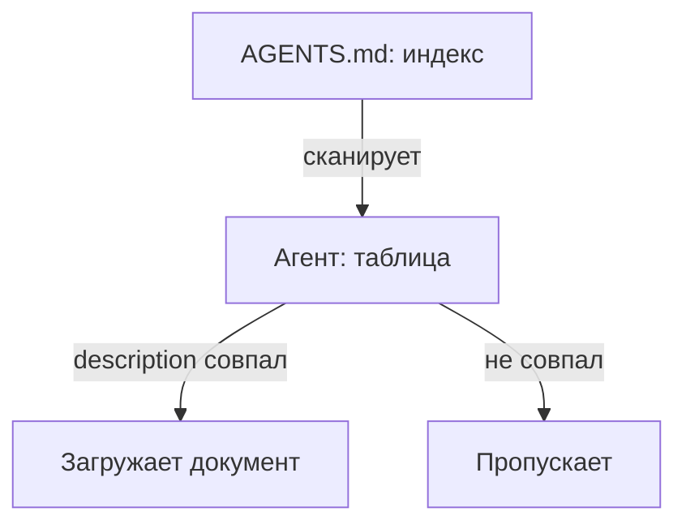

# AGENTS.md Index

> [!info] Определение
> AGENTS.md как lazy-load индекс документов репозитория: агент читает таблицу
> и загружает только релевантные документы. Точка входа каждой сессии.
> См. [[Frontmatter-схемы]], [[Index-First подход]].

## Стандарт / источник

- agentsmd/agents.md; v1.1 proposal: optional frontmatter (description, tags),
  индексный формат (XML/Markdown), progressive disclosure.
- >60,000 open-source проектов (Linux Foundation).
- Реализация: armstrongl/code-docs (docs-sync, docs-staleness workflows).

## Формат

AGENTS.md: короткая преамбула + инструкция по использованию индекса +
генерируемая таблица (один ряд на документ).

```markdown
# AGENTS.md

## Using the docs index

Scan the table below. Load a doc only when its description matches your task.
Do not load docs whose description does not match.

## Available docs

| Doc | Description | Paths | Tags | Status |
|---|---|---|---|---|
| [Authentication flow](docs/auth.md) | Load when changing login, sessions, or tokens | src/auth/** | auth, security | fresh |
| [Billing service](docs/billing.md) | Load when touching payments or invoices | src/billing/** | billing | stale |
```

## Индексный формат (v1.1)

```xml
<agents>
  <agent path="frontend/AGENTS.md">
    <description>React frontend conventions and component patterns.</description>
    <tags>react, frontend, components</tags>
  </agent>
</agents>
```

## Диаграмма



## Мнемоника

**«Индекс, Описание, Точечная загрузка»** — ИОТ.

## Связи

- [[Frontmatter-схемы]] · [[llms.txt]] · [[Index-First подход]] · [[Docs-as-Code и CI]] · [[Актуальность и staleness]]

## Типичные ошибки

> [!warning]
> Индекс вручную: расходится с документами. Используйте генерацию (build-index.py).
> Description как пересказ темы вместо триггера: агент не может решить load-or-skip.
