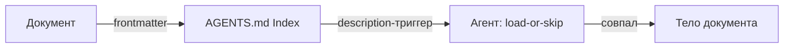

# Frontmatter-схемы

> [!info] Определение
> YAML-шапка документа: машиночитаемая идентичность — что покрывает, когда
> загружать, какие пути кода описывает. Explicit metadata вместо вывода из структуры.
> См. [[AGENTS.md Index]], [[OKF (Open Knowledge Format)]].

## Стандарт / источник

- OKF (Google Cloud): Markdown + YAML frontmatter, обязательный type.
- code-docs schema: title, description, paths, tags, lastValidated, maxAgeDays.
- agent-docs: last_verified, upstream_commit, sources.{docs,repo,changelog,release}.

## Обязательные поля

| Поле | Назначение | Кто пишет |
|---|---|---|
| title | Отображаемое имя в индексе | LLM при создании |
| description | **Триггер**: когда загружать документ | LLM при создании, не обновляется |
| paths | Пути кода, которые описывает документ; для общей энциклопедической заметки без привязки к репозиторию допустимо `[]` | LLM при создании |
| tags | Категории для фильтрации | LLM при создании |

## Поля актуальности

| Поле | Назначение |
|---|---|
| lastValidated | Дата последней проверки человеком |
| maxAgeDays | Через сколько дней документ считается устаревшим |
| upstream_commit | Пин коммита upstream (для smart refresh) |

## Пример

```yaml
---
title: Authentication flow
description: Load when changing login, sessions, tokens, or OAuth callbacks.
paths:
  - src/auth/**
  - src/middleware/session.*
tags: [auth, security]
lastValidated: 2026-10-01
maxAgeDays: 90
---
```

## Ключевое правило

> Description — это **триггер-условие**, а не пересказ темы: агент решает
> load-or-skip, не читая документ.

## Диаграмма



## Мнемоника

**«Название, Триггер, Пути, Теги, Проверено, Возраст»** — НТПТПВ.

## Связи

- [[AGENTS.md Index]] · [[OKF (Open Knowledge Format)]] · [[Актуальность и staleness]] · [[Семантический чанкинг]] · [[LLM Wiki и поддержка Obsidian]]

## Типичные ошибки

> [!warning]
> Description как «Документ про аутентификацию»: агент не знает, когда грузить.
> lastValidated пишет автоматика: дата теряет смысл. Нет paths: документ не привязан к коду.
