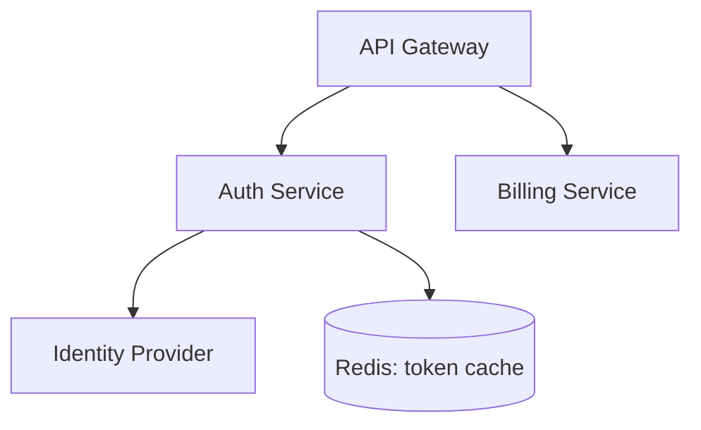

# Mermaid-диаграммы

> [!info] Определение
> Диаграммы как текст в Markdown: архитектура, потоки, error paths — в формате,
> который агент может прочитать, изменить и проверить. См. [[Структурированный Markdown]],
> [[Docs-as-Code и CI]].

## Стандарт / источник

- Mermaid.js; Living Docs: проверка Mermaid-фейнсов в CI (merman-core parser).
- C4/arc42: вьюхи context/container/component/flow/sequence/state/data-model/deployment.

## Формат

| Тип диаграммы | Что описывает |
|---|---|
| flowchart | Потоки, error paths, оркестрация |
| sequenceDiagram | Взаимодействие компонентов |
| classDiagram / erDiagram | Модели данных |
| stateDiagram | Жизненные циклы |
| C4 context/container | Архитектура на уровнях zoom |

## Пример



## Правила

1. Диаграмма рядом с текстом, который она описывает.
2. Имена узлов — реальные имена сервисов/файлов.
3. Проверка синтаксиса в CI (битый фейнс = битая документация).
4. Один уровень абстракции на диаграмму.

## Диаграмма

```mermaid
flowchart LR
    TEXT[Текст] --> MER[[Mermaid-диаграммы|Mermaid]]
    MER -->|рендер| VIEW[Диаграмма]
    MER -->|парсинг| AGENT[Агент]
```

## Мнемоника

**«Текст, Узлы, Проверка, Уровень»** — ТУПЛ.

## Связи

- [[Структурированный Markdown]] · [[Docs-as-Code и CI]] · [[OKF (Open Knowledge Format)]] · [[Пример структуры docs]]

## Типичные ошибки

> [!warning]
> Диаграмма без проверки в CI: синтаксис ломается молча. Все уровни абстракции
> в одной диаграмме: нечитаемо и агенту, и человеку. Абстрактные имена узлов:
> агент не связывает диаграмму с кодом.
