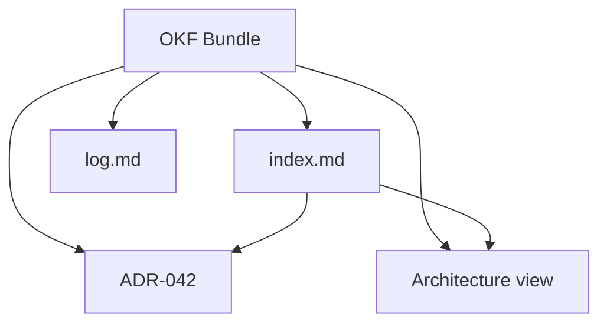

# OKF (Open Knowledge Format)

> [!info] Определение
> Вендор-нейтральный формат знаний от Google Cloud Platform: Markdown + YAML
> frontmatter, обязательный type, зарезервированные index.md/log.md, bundle-relative
> ссылки. Портативный и агент-парсябельный корпус знаний.
> См. [[Frontmatter-схемы]], [[Docs-as-Code и CI]].

## Стандарт / источник

- Google Cloud Platform; вендорится в Living Docs (skills/okf-knowledge-format/).
- Цель: корпус знаний, остающийся портативным и парсябельным агентами.

## Формат

| Элемент | Назначение |
|---|---|
| Markdown + YAML frontmatter | Тело + машиночитаемая идентичность |
| type (обязателен) | Тип документа: ADR, PRD, architecture view… |
| index.md | Индекс бандла (зарезервирован) |
| log.md | Журнал изменений (зарезервирован) |
| Bundle-relative links | Ссылки внутри бандла, не абсолютные |

## Пример

```yaml
---
type: adr
title: "ADR-042: Event sourcing for billing"
status: accepted
date: 2026-09-15
supersedes: []
superseded_by: []
---
```

## Диаграмма



## Мнемоника

**«Тип, Индекс, Журнал, Ссылки»** — ТИЖС.

## Связи

- [[Frontmatter-схемы]] · [[Docs-as-Code и CI]] · [[Структурированный Markdown]] · [[Mermaid-диаграммы]]

## Типичные ошибки

> [!warning]
> Нет type: документ не классифицируется автоматически. Абсолютные ссылки: бандл
> непереносим. index.md вручную: используйте генерацию.
