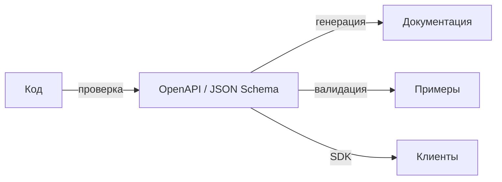

# OpenAPI и JSON Schema

> [!info] Определение
> Авторитетные контракты API и данных: версионированные схемы, из которых
> генерируется документация. Агент читает контракт, а не прозу.
> См. [[Docs-as-Code и CI]], [[Структурированный Markdown]].

## Стандарт / источник

- OpenAPI Initiative (API-описания); JSON Schema (структура данных).
- Stripe — эталон AI-readable API документации.
- Практика: генерация API-документации из OpenAPI в CI; валидация примеров по схемам.

## Формат

| Аспект | Значение |
|---|---|
| Версионирование | Схема — источник правды; версия в контракте |
| Генерация | Документация и SDK генерируются из схемы |
| Валидация | Примеры и события проверяются по JSON Schema в CI |
| Дрейф | Сборка падает при расхождении документации и схемы |

## Пример (OpenAPI фрагмент)

```yaml
paths:
  /orders:
    post:
      operationId: createOrder
      requestBody:
        required: true
        content:
          application/json:
            schema:
              $ref: '#/components/schemas/CreateOrderRequest'
      responses:
        '201':
          description: Created
          content:
            application/json:
              schema:
                $ref: '#/components/schemas/Order'
```

## Диаграмма



## Мнемоника

**«Схема, Генерация, Валидация, Дрейф»** — СГВД.

## Связи

- [[Docs-as-Code и CI]] · [[Структурированный Markdown]] · [[AI-Native Documentation]] · [[Актуальность и staleness]]

## Типичные ошибки

> [!warning]
> Документация вручную при наличии схемы: дрейф. Примеры без валидации по схеме:
> агент копирует неверные примеры. Схема без версионирования: breaking changes молча.
