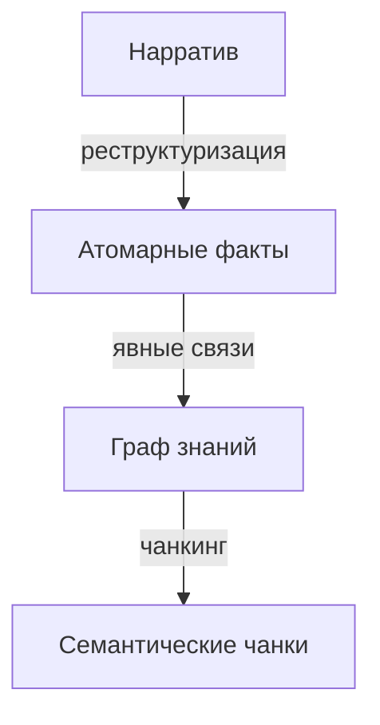

# Структурированный Markdown

> [!info] Определение
> Markdown, написанный для машин: чёткие иерархии, консистентное форматирование,
> атомарные единицы информации, явные связи. Человек интерполирует недостающее —
> агент не может. См. [[AI-Native Documentation]], [[Семантический чанкинг]].

## Стандарт / источник

- AI-native documentation (Docgrity, DocsAlot); IBM: +47% точности при структурированных доках.
- Принцип: «explicit over implicit» — связи компонентов явные, а не выводимые из структуры.

## Правила структуры

| Правило | Почему |
|---|---|
| Чёткие иерархии (H1→H2→H3) | Машина парсит структуру предсказуемо |
| Атомарные единицы | Факт извлекается без окружающего контекста |
| Явные связи | «X использует Y» — текстом, а не расположением |
| Консистентное форматирование | Таблицы, списки, код — одинаково везде |
| Конкретные пути и имена | Файлы, параметры, ожидаемое поведение — явно |

## Пример: было / стало

```markdown
# Было (нарратив)
Authentication is handled by our gateway service which talks to the identity
provider and caches tokens for performance. Make sure to update the config
when rotating keys...

# Стало (структура)
## Authentication

- Service: `src/auth/gateway.ts`
- Provider: Identity Provider (OAuth 2.0)
- Token cache: Redis, TTL 300s
- Key rotation: `pnpm auth:rotate-keys` (см. docs/ops/rotation.md)
```

## Диаграмма



## Мнемоника

**«Иерархия, Атомарность, Явность, Консистентность»** — ИАЯК.

## Связи

- [[AI-Native Documentation]] · [[Семантический чанкинг]] · [[Frontmatter-схемы]] · [[Mermaid-диаграммы]]

## Типичные ошибки

> [!warning]
> Нарратив с неявным контекстом: агент теряет смысл. Раздел «Authentication» в папке
> api-gateway без явных связей: машина не выводит значение из пути. Противоречия:
> человек заметит, агент усреднит.
