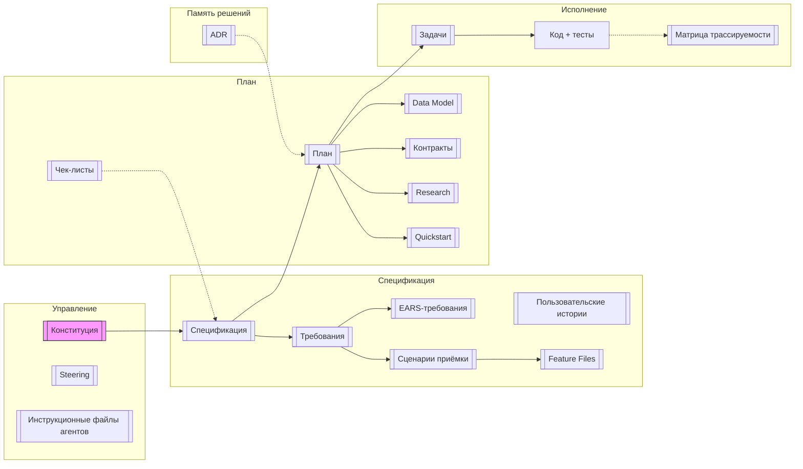
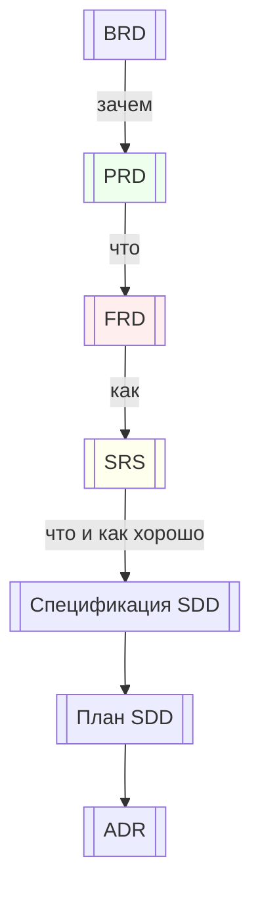

# 🏠 Энциклопедия SDD: форматы и содержание спецификаций

Самодостаточное хранилище (Obsidian vault) о Specification-Driven Development:
каждая сущность — отдельная страница с форматом файла, содержанием, примером,
диаграммой, мнемоникой и связями. Навигация — через `[[wikilink]]`, теги `#сущность`,
`#стандарт`, `#инструмент`, `#процесс`.

> [!tip] Как читать
> Начните с [[Workflow SDD]] (карта процесса), затем откройте страницы сущностей
> по порядку конвейера. Каждая страница самодостаточна: определение → формат →
> содержание → пример → диаграмма → мнемоника → связи.

## Карта конвейера SDD

## Мнемоника конвейера

**«Конституция Специфицирует План, Задачи Реализуют»** → **КСПЗР**

| Буква | Сущность | Вопрос |
|---|---|---|
| К | [[Конституция]] | Какие правила нельзя нарушать? |
| С | [[Спецификация]] | Что строим и зачем? |
| П | [[План]] | Как строим? |
| З | [[Задачи]] | В каком порядке? |
| Р | Реализация | Код + тесты |

## Разделы энциклопедии

### Сущности (ядро)
- [[Конституция]] · [[Спецификация]] · [[План]] · [[Задачи]]
- [[Требования]] · [[Пользовательские истории]] · [[Сценарии приёмки]] · [[EARS-требования]]
- [[Data Model]] · [[Контракты]] · [[Research]] · [[Quickstart]] · [[Чек-листы]]
- [[Proposal]] · [[Delta Specs]] · [[ADR]]
- [[PRD]] · [[RFC Design Doc]] · [[SRS]] · [[BRD]] · [[FRD]] · [[ТЗ по ГОСТ 19]]
- [[Steering]] · [[Инструкционные файлы агентов]] · [[Feature Files]] · [[Матрица трассируемости]]

### Стандарты
- [[IEEE 830]] · [[ISO 29148]] · [[RFC 2119]] · [[ГОСТ 19]] · [[INCOSE Guide]]

### Инструменты
- [[GitHub Spec Kit]] · [[Kiro]] · [[OpenSpec]] · [[BMAD]]

### Процессы
- [[Workflow SDD]] · [[Внедрение SDD]] · [[SDD в CI-CD]]

### Флоу
- [[Стандарты описания флоу]] — BPMN, UML, ISO 5807/ГОСТ 19.701-90, DFD, сети Петри и все варианты флоу

### Справочник
- [[Справочник сущностей]] — единый каталог всех сущностей с форматами и ссылками
- [[Глоссарий]]

## Документы-уровни: кто отвечает на какой вопрос

**Мнемоника уровней:** «Зачем? Что? Как? Что и как хорошо?» — **ЗЧКЧ**.

## Принципы этого хранилища

1. Одна сущность — одна страница (атомарность).
2. Каждая страница: определение, формат, содержание, пример, диаграмма, мнемоника, связи.
3. Связи — `[[wikilink]]`; обратные ссылки Obsidian строит автоматически.
4. Теги: `#сущность`, `#стандарт`, `#инструмент`, `#процесс`, `#sdd`.
5. Диаграммы — Mermaid (рендерятся в Obsidian и GitHub).

---
*Энциклопедия собрана из исследования SDD (ноябрь 2026). Источники — в конце каждой страницы.*
