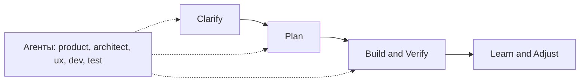

# BMAD Method

> [!info] Определение
> Полноценная agile-методология (MIT) через именованных агентов с ролями:
> product, architecture, UX, development, testing. Самая «тяжёлая» методология SDD.
> См. [[PRD]].

## Фазы

**Clarify → Plan → Build and Verify → Learn and Adjust**

## Артефакты

- Briefs, [[PRD]], architecture-документы
- Initiative → epic → story tickets
- Quick Flow (tech spec) для мелких задач

## Диаграмма

## Мнемоника

**«Уточни, Спланируй, Собери и Проверь, Учись и Корректируй»** — УСПСУК.

## Связи

- [[PRD]] · [[Спецификация]] · [[План]] · [[Workflow SDD]]

## Сильные/слабые стороны

Плюс: продуктовое и архитектурное мышление, роли агентов.
Минус: каждая фаза — вызовы модели (расходы на API); высокая церемония.
