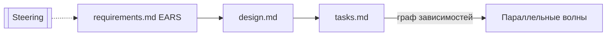

# Kiro (AWS)

> [!info] Определение
> Коммерческая agentic IDE от AWS (июль 2025, GA — ноябрь 2025) со встроенными спеками.
> Приемник Amazon Q Developer. См. [[EARS-требования]], [[Steering]].

## Артефакты спеки

```
.kiro/
├── specs/<name>/
│   ├── requirements.md   # истории + критерии в EARS (баги — bugfix.md)
│   ├── design.md         # архитектура, sequence, данные, ошибки, тесты
│   └── tasks.md          # граф зависимостей, параллельные волны
└── steering/             # контекст проекта
```

## Режимы

- **Feature Spec**: requirements-first или design-first; гейты утверждения между фазами.
- **Quick Spec**: без гейтов (для мелких изменений).
- **Analyze Requirements**: проверка требований до дизайна.
- **Hooks**: тесты/линтеры/сканы по событиям.

## Диаграмма



## Мнемоника

**«Требования, Дизайн, Задачи»** — ТДЗ: три файла спеки Kiro.

## Связи

- [[EARS-требования]] · [[Steering]] · [[Спецификация]] · [[План]] · [[Задачи]]

## Сильные/слабые стороны

Плюс: EARS, трассируемость, интеграция с AWS.
Минус: vendor lock-in (своя IDE), кредиты ($20–$200/мес), избыточен для мелких задач.
