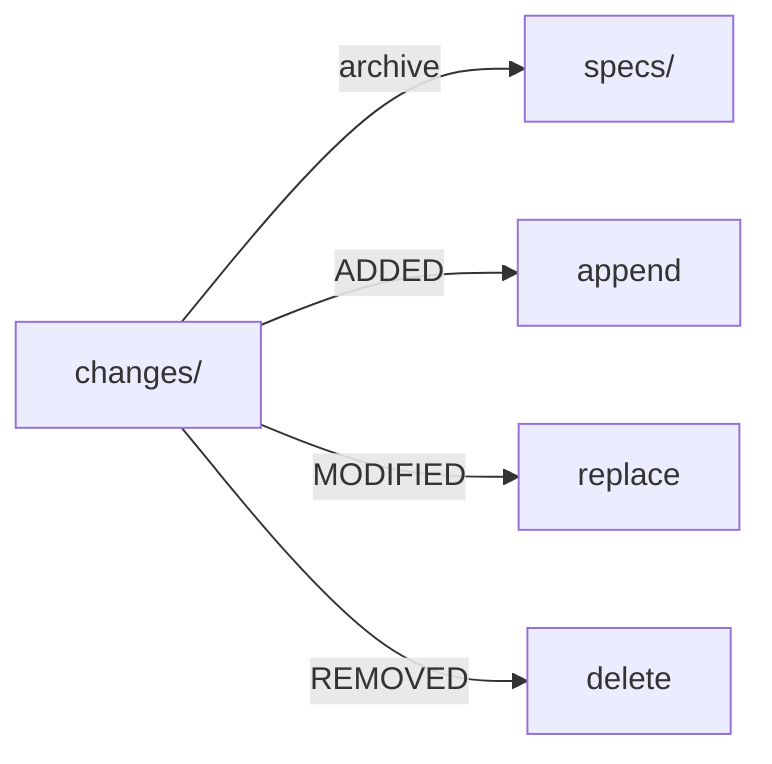

# OpenSpec

> [!info] Определение
> Open-source CLI (MIT, Fission AI) для spec-driven изменений в существующих кодовых
> базах (brownfield-first). См. [[Proposal]], [[Delta Specs]].

## Ментальная модель: два каталога

```
openspec/
├── specs/<domain>/spec.md       # как система ведёт себя СЕЙЧАС
├── changes/<change-name>/
│   ├── proposal.md
│   ├── design.md (опционально)
│   ├── tasks.md
│   └── specs/<domain>/spec.md   # дельта ADDED/MODIFIED/REMOVED
└── config.yaml
```

## Workflow

`/opsx:explore` → `/opsx:propose` → `/opsx:apply` → `/opsx:verify` → `/opsx:archive`
(дельты сливаются в `specs/`, изменение — в `changes/archive/<date>-<name>/`).

## Диаграмма



## Мнемоника

**«Предложить, Применить, Проверить, Архивировать»** — ПППА.

## Связи

- [[Proposal]] · [[Delta Specs]] · [[Спецификация]] · [[Задачи]]

## Сильные/слабые стороны

Плюс: лёгкий вес, brownfield, параллельные изменения без конфликтов, история аудита.
Минус: нет гейтов между фазами; validate проверяет структуру, а не поведение;
главная жалоба — ручной дрейф спек.
