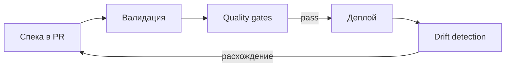

# SDD в CI/CD

> [!info] Определение
> Интеграция spec-driven workflow в конвейер: валидация спек, quality gates,
> drift detection. Принцип: CI — исполнитель, а не судья. См. [[Workflow SDD]].

## 6 стадий пайплайна

1. Specification validation (синтаксис, семантика, стандарты)
2. Code generation trigger (при коммите спек)
3. Generated code validation
4. Testing integration (спека↔реализация)
5. Quality gates
6. Deployment automation

## Валидация спек: 3 уровня

| Уровень | Проверки | Инструменты |
|---|---|---|
| Синтаксис | Markdown-линт, структура, ссылки | markdownlint, lychee, check-prerequisites.sh |
| Семантика | Дельты, трассируемость, контракты | `openspec validate`, spectral, AsyncAPI Validator |
| Стандарты | Конституция, EARS, шаблоны | /speckit.analyze, Kiro Analyze |

## Quality gates на сгенерированный код

SonarQube (static), OWASP ZAP (security), perf-тесты (SLA из NFR),
converge/verify (спека↔код), contract tests. Проваленные гейты блокируют деплой.

## Drift detection

Непрерывное сравнение спек с задеплоенными API; сигналы: schema failures,
contract-test failures, частота ревизий спек, spec/code context ratio.
Audit trail: baseline → approved → generation record → drift log → reconciliation.

## Диаграмма

## Мнемоника

**«Валидация, Генерация, Гейты, Тесты, Деплой, Мониторинг»** — ВГГТДМ.

## Связи

- [[Workflow SDD]] · [[Контракты]] · [[Матрица трассируемости]] · [[Внедрение SDD]]
