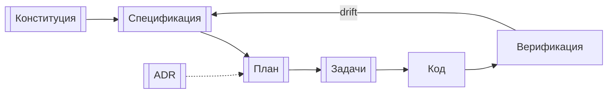

# Workflow SDD

> [!info] Определение
> Канонический конвейер spec-driven development: конституция → спека → план → задачи →
> реализация → верификация. Конвергенция [[GitHub Spec Kit]], [[Kiro]], [[OpenSpec]].
> См. [[Главная]].

## Фазы и гейты

| Фаза | Артефакт | Гейт |
|---|---|---|
| Конституция | [[Конституция]] | Ревью мейнтейнерами |
| Спецификация | [[Спецификация]] | Ревью PO/техлида |
| Clarify | Дополнения в спеку | Ответы на 5–10 вопросов |
| План | [[План]] | Constitution Check + ревью |
| Задачи | [[Задачи]] | Сверка с планом |
| Реализация | Код, тесты | analyze / converge / verify |
| Архивирование | [[Delta Specs]] → живые спеки | OpenSpec archive |

## Диаграмма

## Мнемоника

**«Конституция Специфицирует План, Задачи Реализуют»** — КСПЗР.

## Связи

- [[Главная]] · [[GitHub Spec Kit]] · [[Kiro]] · [[OpenSpec]] · [[Внедрение SDD]] · [[SDD в CI-CD]] · [[Стандарты описания флоу]]
