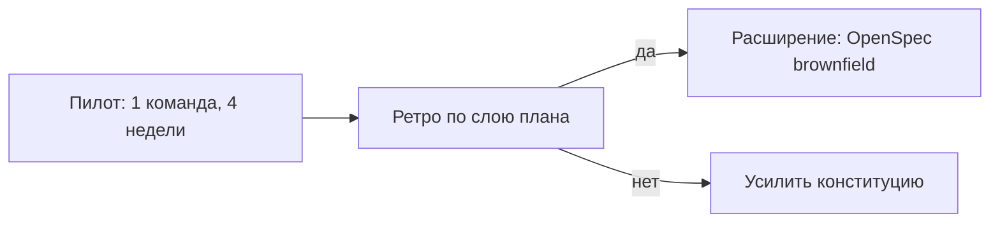

# Внедрение SDD

> [!info] Определение
> Как внедрить spec-driven development в команду: инкрементально, через дельты,
> с гейтами и метриками. См. [[Workflow SDD]], [[SDD в CI-CD]].

## 5 шагов brownfield

1. Зафиксировать baseline (DORA: lead time, change failure rate).
2. Scope спеки — только изменение (дельта), не вся система.
3. Записать текущее поведение рядом с изменением.
4. Машиночитаемые контракты (схемы в CI).
5. Верификация против спеки и существующих тестов.

## Rollout по организации

| Стадия | Действие |
|---|---|
| Pick the corner | Один high-stakes сервис, команда с лучшей дисциплиной |
| Train | Практика на реальном бэклоге, еженедельные сессии |
| Gates | Конституция, review gate, доказательства приёмки |
| Drift visible | Baseline'ы, drift-проверки, reconciliation |
| Centralise | Общие спеки, model tiering, pre-screening |

## Governance

**AI пишет спеки, люди утверждают гейты, CI исполняет контракты.**
Гейты: Baseline → DoR → Build-Ready → Handoff → Closure.

## Диаграмма

## Мнемоника

**«Угол, Обучение, Гейты, Дрейф, Централизация»** — УОГДЦ.

## Связи

- [[Workflow SDD]] · [[SDD в CI-CD]] · [[Конституция]] · [[OpenSpec]]
