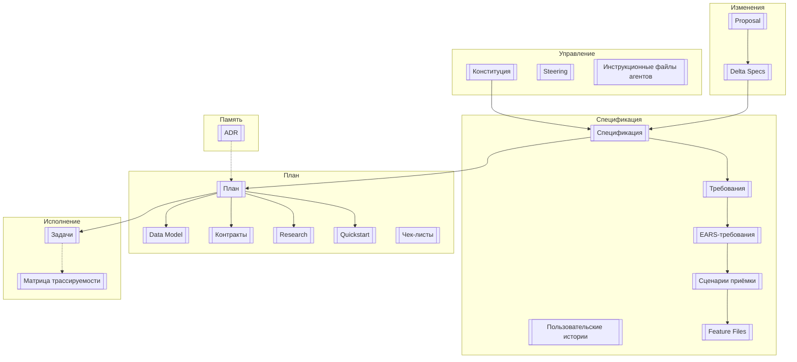

# 📖 Справочник сущностей документации

Единый каталог всех сущностей SDD и классической документации: файл, стандарт,
формат, назначение и ссылка на полную страницу энциклопедии.
См. [[Главная]] (карта конвейера) и [[Глоссарий]] (термины).

## Карта сущностей

## 1. Сущности SDD (ядро)

| Сущность | Файл / расположение | Стандарт / источник | Формат | Назначение | Страница |
|---|---|---|---|---|---|
| Конституция | `.specify/memory/constitution.md` | [[GitHub Spec Kit]] | Markdown | Неизменяемые принципы проекта | [[Конституция]] |
| Спецификация | `specs/NNN-name/spec.md` | Spec Kit / [[Kiro]] / [[OpenSpec]] | Markdown | Что и зачем (без реализации) | [[Спецификация]] |
| План | `specs/NNN-name/plan.md` | Spec Kit / Kiro (`design.md`) | Markdown + Mermaid | Как реализуем | [[План]] |
| Задачи | `specs/NNN-name/tasks.md` | Spec Kit / Kiro / OpenSpec | Markdown, чекбоксы | Декомпозиция с зависимостями | [[Задачи]] |
| Требования | Раздел spec.md / requirements.md | [[ISO 29148]], [[IEEE 830]] | Markdown | FR/NFR, проверяемые утверждения | [[Требования]] |
| Пользовательские истории | Раздел spec.md | Agile, INVEST | Markdown | Потребности пользователей, P1/P2/P3 | [[Пользовательские истории]] |
| Сценарии приёмки | Раздел spec.md | Gherkin/BDD | Given/When/Then | Конкретные примеры поведения | [[Сценарии приёмки]] |
| EARS-требования | requirements.md (Kiro) | EARS, Rolls-Royce 2009 | Текстовая нотация | Однозначные требования | [[EARS-требования]] |
| Data Model | `data-model.md` | Spec Kit | Markdown + ER | Схема данных, сущности, связи | [[Data Model]] |
| Контракты | `contracts/api-spec.json` | OpenAPI 3.x | YAML/JSON | Машиночитаемые интерфейсы | [[Контракты]] |
| Research | `research.md` | Spec Kit | Markdown | Технологии: версии, альтернативы | [[Research]] |
| Quickstart | `quickstart.md` | Spec Kit | Markdown | Сценарии ручной валидации | [[Quickstart]] |
| Чек-листы | `checklists/` | Spec Kit | Markdown | Контроль качества артефактов | [[Чек-листы]] |
| Proposal | `openspec/changes/<name>/proposal.md` | [[OpenSpec]] | Markdown | Почему и что (намерение) | [[Proposal]] |
| Delta Specs | `changes/<name>/specs/<domain>/spec.md` | OpenSpec | Markdown | ADDED/MODIFIED/REMOVED | [[Delta Specs]] |
| ADR | `docs/adr/NNNN-title.md` | Nygard 2011, MADR 2018 | Markdown | Архитектурные решения | [[ADR]] |
| Steering | `.kiro/steering/*.md` | [[Kiro]] | Markdown | Долгосрочный контекст проекта | [[Steering]] |
| Инструкционные файлы | `AGENTS.md`, `CLAUDE.md` | Стандарт 2026 | Markdown | Инструкции для AI-агентов | [[Инструкционные файлы агентов]] |
| Feature Files | `*.feature` | Gherkin, Cucumber | Gherkin | Исполняемые спеки, living docs | [[Feature Files]] |
| Матрица трассируемости | Таблица / ссылки FR-XXX | [[IEEE 830]], [[ISO 29148]] | Markdown-таблица | Требования ↔ дизайн ↔ тесты ↔ код | [[Матрица трассируемости]] |

## 2. Документы верхнего уровня (классика)

| Документ | Вопрос | Автор | Стандарт | Страница |
|---|---|---|---|---|
| BRD | Зачем бизнесу? | Бизнес-аналитик | [[ISO 29148]] (BRS) | [[BRD]] |
| PRD | Что строим и для кого? | Product Manager | Atlassian, [[BMAD]] | [[PRD]] |
| FRD | Как ведёт себя система? | Аналитик | Enterprise-практика | [[FRD]] |
| SRS | Что должно делать ПО и как хорошо? | Аналитик/инженер | [[IEEE 830]], [[ISO 29148]] | [[SRS]] |
| ТЗ | Что заказано и как принимается? | Заказчик | [[ГОСТ 19]] (19.201-78) | [[ТЗ по ГОСТ 19]] |
| RFC / Design Doc | Как построим и почему так? | Архитектор | Google, IETF, Uber | [[RFC Design Doc]] |

**Мнемоника уровней:** «Зачем? Что? Как? Что и как хорошо?» — **ЗЧКЧ**.

## 3. Стандарты

| Стандарт | Область | Страница |
|---|---|---|
| [[IEEE 830]] | Структура SRS, 8 характеристик качества | [[IEEE 830]] |
| [[ISO 29148]] | Инженерия требований, BRS→StRS→SyRS→SRS | [[ISO 29148]] |
| [[RFC 2119]] | Сила слов MUST/SHOULD/MAY | [[RFC 2119]] |
| [[ГОСТ 19]] | ЕСПД: ТЗ, проекты, руководства | [[ГОСТ 19]] |
| [[INCOSE Guide]] | Правила написания требований | [[INCOSE Guide]] |
| [[Стандарты описания флоу]] | BPMN, UML, ISO 5807, DFD, сети Петри | [[Стандарты описания флоу]] |

## 4. Инструменты

| Инструмент | Тип | Артефакты | Страница |
|---|---|---|---|
| [[GitHub Spec Kit]] | Toolkit (MIT) | constitution, spec, plan, tasks | [[GitHub Spec Kit]] |
| [[Kiro]] | IDE (AWS) | requirements (EARS), design, tasks | [[Kiro]] |
| [[OpenSpec]] | CLI (MIT) | proposal, delta specs, design, tasks | [[OpenSpec]] |
| [[BMAD]] | Методология (MIT) | briefs, PRD, architecture, stories | [[BMAD]] |

## 5. Процессы

| Процесс | Суть | Страница |
|---|---|---|
| [[Workflow SDD]] | Конвейер: конституция → спека → план → задачи → код | [[Workflow SDD]] |
| [[Внедрение SDD]] | Brownfield, rollout, governance-гейты, метрики | [[Внедрение SDD]] |
| [[SDD в CI-CD]] | Валидация спек, quality gates, drift detection | [[SDD в CI-CD]] |

## 6. Быстрый выбор сущности по задаче

| Задача | Сущность |
|---|---|
| Зафиксировать правила проекта | [[Конституция]] / [[Steering]] |
| Описать поведение фичи | [[Спецификация]] + [[Требования]] |
| Сформулировать требования однозначно | [[EARS-требования]] |
| Сделать критерии исполняемыми | [[Сценарии приёмки]] / [[Feature Files]] |
| Спроектировать архитектуру | [[План]] / [[RFC Design Doc]] |
| Описать данные | [[Data Model]] |
| Описать API | [[Контракты]] |
| Разбить на шаги | [[Задачи]] |
| Записать решение | [[ADR]] |
| Предложить изменение (brownfield) | [[Proposal]] + [[Delta Specs]] |
| Проверить покрытие | [[Матрица трассируемости]] + [[Чек-листы]] |
| Настроить контекст агента | [[Инструкционные файлы агентов]] |

## 7. Мнемоники (сводно)

| Набор | Мнемоника |
|---|---|
| Конвейер SDD | «Конституция Специфицирует План, Задачи Реализуют» — КСПЗР |
| EARS | «Всегда Когда Пока Если Где» — ВКПЕГ |
| IEEE 830 (8 характеристик) | КОПС-РВМТ |
| ADR | «Контекст — Решение — Последствия» — КРП |
| Delta Specs | «Добавили, Изменили, Удалили, Переименовали» — ДИУП |
| Уровни документов | «Зачем? Что? Как? Что и как хорошо?» — ЗЧКЧ |
| Типы требований | «Бизнес, Пользователь, Функции, Нефункции» — БПФН |
| Верификация | «Тест, Демо, Инспекция, Анализ» — ТДИА |
| Spec Kit команды | КСУПЧДАРС |

## Связи

- [[Главная]] · [[Глоссарий]] · [[Workflow SDD]] · [[Стандарты описания флоу]]
