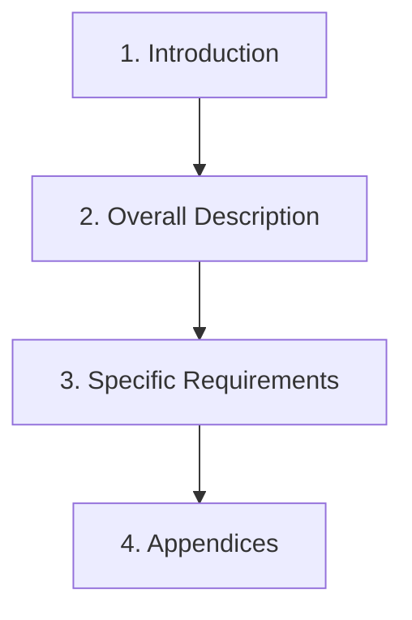

# IEEE 830-1998

> [!info] Определение
> Рекомендуемая практика для SRS: структура документа и 8 характеристик качества.
> Формально заменён [[ISO 29148]], но шаблон — де-факто база в регулируемых отраслях.
> См. [[SRS]].

## Структура SRS

1. **Introduction** — назначение, область, определения, ссылки, обзор
2. **Overall Description** — перспектива, функции, пользователи, ограничения, допущения
3. **Specific Requirements** (60–70% объёма):
   - 3.1 External Interface Requirements
   - 3.2 Functional Requirements
   - 3.3 Performance Requirements
   - 3.4 Design Constraints
   - 3.5 Software System Attributes
   - 3.6 Other Requirements
4. **Appendices** — глоссарий, матрица трассируемости, история

## 8 характеристик качества

| Характеристика | Смысл |
|---|---|
| Correctness | Точно описывает нужную функцию |
| Unambiguity | Одна интерпретация |
| Completeness | Все ситуации, включая невалидный ввод |
| Consistency | Нет противоречий |
| Ranking | Приоритеты указаны |
| Verifiability | Можно проверить |
| Modifiability | Легко изменять |
| Traceability | Связано с источником и реализацией |

## Диаграмма

## Мнемоника

**КОПС-РВМТ** — «Корректность, Однозначность, Полнота, Согласованность, Ранжирование,
Верифицируемость, Модифицируемость, Трассируемость».

## Связи

- [[SRS]] · [[ISO 29148]] · [[Требования]] · [[Матрица трассируемости]] · [[Чек-листы]]
