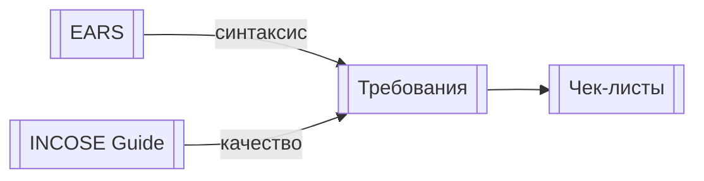

# INCOSE Guide to Writing Requirements

> [!info] Определение
> Стандарт де-факто качества формулировок требований (INCOSE RWG).
> Работает в паре с [[EARS-требования|EARS]]: синтаксис + критерии качества.
> См. [[Требования]], [[Чек-листы]].

## Ключевые правила

1. Одно требование — одно обязательство (C5).
2. Отдельная клауза на каждое условие (R11).
3. Позитивные формулировки, активный залог.
4. Измеримые значения вместо прилагательных.
5. Один provision (shall/must) на требование.
6. Наблюдаемый отклик (экран, сообщение, измерение).
7. Без деталей реализации.
8. Стабильные ID (REQ-CART-01).
9. Rationale — в отдельном поле, не в тексте требования.

## Пример: до / после

```markdown
❌ The system should be fast and user-friendly.
✅ WHEN the user submits a search, the search service SHALL show results
   within 2 seconds.
```

## Диаграмма



## Мнемоника

**«Одно, Отдельно, Позитивно, Измеримо, Один provision, Наблюдаемо, Без реализации, ID, Зачем»** — ООПИОНБИЗ.

## Связи

- [[EARS-требования]] · [[Требования]] · [[Чек-листы]] · [[ISO 29148]]
