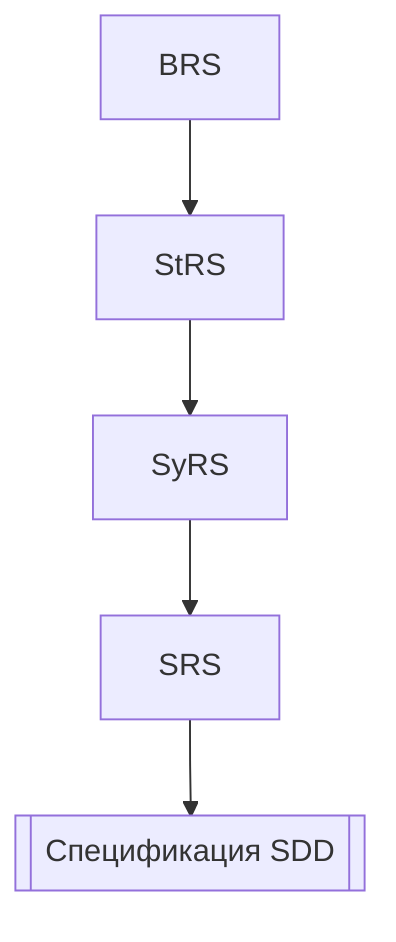

# ISO/IEC/IEEE 29148:2018

> [!info] Определение
> Действующий стандарт инженерии требований: весь жизненный цикл, а не только документ.
> Заменил [[IEEE 830]] в 2011/2018. См. [[SRS]], [[Требования]].

## Уровни спецификаций

| Спецификация | Содержимое |
|---|---|
| BRS | Бизнес-/миссионные требования |
| StRS | Требования стейкхолдеров |
| SyRS | Требования к системе |
| SRS | Требования к ПО |

## Атрибуты требования

Id, Heading, Text, Owner, Priority, Source, Rationale, Difficulty, Type, Status,
Verification Method (Test / Demonstration / Inspection / Analysis).

## Правила формулировок

- Позитивные утверждения, активный залог; избегать «shall not».
- Избегать «must» (двусмысленность); один provision на требование.
- Типы: Functional, Performance, Usability, Interface, Design Constraints,
  Non-Functional/Quality («-ilities»), Human Factors.

## Диаграмма

## Мнемоника

**«Бизнес, Стейкхолдер, Система, Софт»** — БССС: четыре уровня спецификаций.

## Связи

- [[IEEE 830]] · [[SRS]] · [[Требования]] · [[EARS-требования]] · [[INCOSE Guide]]
