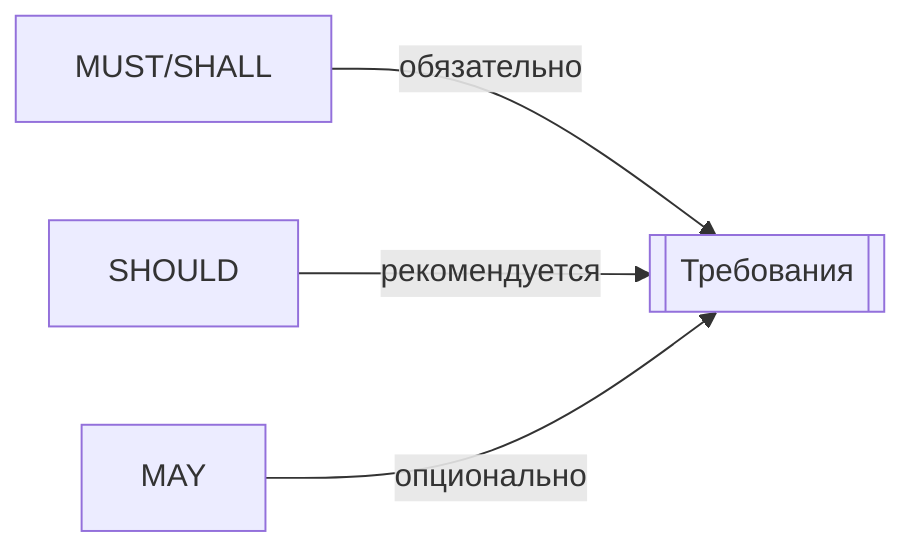

# RFC 2119 / RFC 8174

> [!info] Определение
> Нормативные ключевые слова спецификаций: сила модальных глаголов. RFC 8174 (2017)
> уточняет: сила — только в верхнем регистре. См. [[EARS-требования]], [[Требования]].

## Таблица ключевых слов

| Ключевое слово | Значение |
|---|---|
| MUST / SHALL / REQUIRED | Абсолютное требование |
| MUST NOT / SHALL NOT | Абсолютный запрет |
| SHOULD / RECOMMENDED | Рекомендуется; отклонение — с обоснованием |
| SHOULD NOT | Не рекомендуется |
| MAY / OPTIONAL | На усмотрение |

## Практика требований

- **SHALL** — функциональные требования.
- **MUST** — нефункциональные (качественные) с методом верификации.
- Агент читает SHOULD как «можно пропустить» — выбирайте силу осознанно.

## Пример

```markdown
- The system SHALL expire sessions after 30 minutes. (обязательно)
- The system SHOULD cache responses. (рекомендуется)
- The system MAY log debug info. (опционально)
```

## Диаграмма



## Мнемоника

**«Должен, Следует, Может»** — ДСМ: три уровня силы.

## Связи

- [[EARS-требования]] · [[Требования]] · [[Delta Specs]] · [[ISO 29148]]
