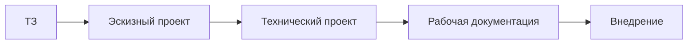

# ГОСТ 19 (ЕСПД)

> [!info] Определение
> Единая система программной документации: серия ГОСТов 1978–1990 гг. о документах
> жизненного цикла ПО. См. [[ТЗ по ГОСТ 19]].

## Состав серии

| ГОСТ | Документ |
|---|---|
| 19.201-78 | Техническое задание |
| 19.202-78 | Эскизный проект |
| 19.401-78 | Текст программы |
| 19.402-78 | Описание программы |
| 19.404-79 | Пояснительная записка |
| 19.501-78 | Описание применения |
| 19.502-78 | Описание алгоритма |
| 19.503-79 | Руководство программиста |
| 19.504-79 | Руководство оператора |
| 19.505-79 | Руководство пользователя |
| 19.506-79 | Описание языка |
| 19.507-79 | Ведомость держателей подлинников |
| 19.508-79 | Руководство системного программиста |
| 19.701-90 | Схемы алгоритмов, программ, данных и систем |

## Стадии жизненного цикла

## Мнемоника

**«ТЗ, Эскиз, Техпроект, Рабочая, Внедрение»** — ТЭТРВ.

## Связи

- [[ТЗ по ГОСТ 19]] · [[SRS]] · [[IEEE 830]]
