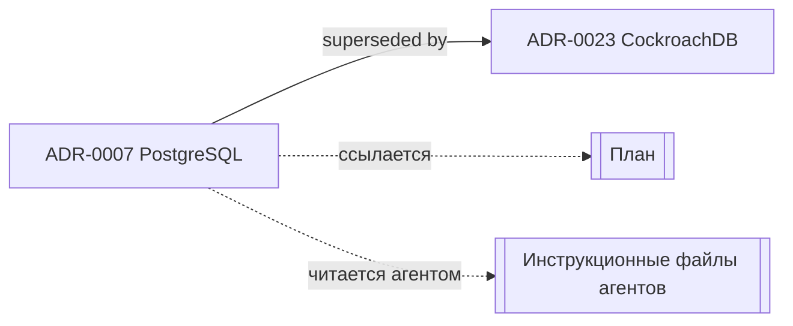

# ADR (Architecture Decision Records)

> [!info] Определение
> Короткая запись одного архитектурного решения: контекст, решение, последствия.
> Долгоживущий слой памяти: код показывает «что», ADR — «почему». См. [[План]], [[RFC Design Doc]].

## Стандарт / источник

- **Nygard (2011)**: Title, Status, Date, Context, Decision, Consequences.
- **MADR (2018)**: + Decision Drivers, Considered Options, Pros/Cons of the Options.
- Инструменты: adr-tools (Nat Pryce), Log4brains, docToolchain.
- Связь со стандартом: decision log по [[ISO 29148|ISO/IEC/IEEE 42010]].

## Формат файла

| Аспект | Значение |
|---|---|
| Расположение | `docs/adr/` в репозитории |
| Имя | `NNNN-title-with-dashes.md` (например, `0007-use-postgresql-for-orders.md`) |
| Индекс | `docs/adr/README.md` (decision log) |
| Синтаксис | Markdown, 1–2 страницы |
| Жизненный цикл | Append-only; отмена — новый ADR, старый помечается Superseded |

## Содержание (Nygard)

1. Title + Status (Proposed/Accepted/Deprecated/Superseded) + Date + Deciders
2. **Context** — проблема, силы, ограничения, альтернативы
3. **Decision** — директива: «Мы будем использовать…»
4. **Consequences** — позитивные, негативные, нейтральные (честно!)
5. **Alternatives considered** — что отклонили и почему
6. **Links** — связанные ADR, прототипы, RFC

## Пример

```markdown
# ADR-0007: Use PostgreSQL for orders

- Status: Accepted
- Date: 2026-10-14
- Deciders: [имена]

## Context
Нужна транзакционная БД с сильными гарантиями для заказов.
Рассматривали PostgreSQL, MySQL, MongoDB.

## Decision
Мы будем использовать PostgreSQL как основное хранилище заказов.

## Consequences
- Плюс: ACID, зрелая экосистема, JSONB.
- Минус: вертикальное масштабирование; нужен шардинг при росте.
- Нейтрально: команда уже знает PostgreSQL.

## Alternatives considered
- MongoDB: отклонён — нужны транзакции между сущностями.
- MySQL: отклонён — слабее JSONB и оконные функции.
```

## Диаграмма



## Мнемоника

**«Контекст — Решение — Последствия»** — КРП.

## Связи

- [[План]] · [[Research]] · [[RFC Design Doc]] · [[Инструкционные файлы агентов]] · [[Конституция]]

## Типичные ошибки

> [!warning]
> Редактирование принятого ADR (теряется аудит); ADR только с плюсами (сломан);
> ADR на тривиальные решения (нейминг переменных).
