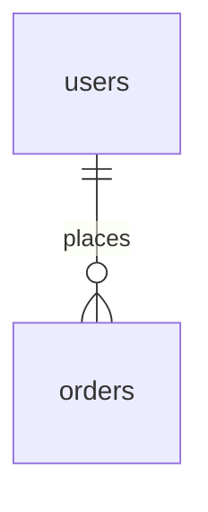
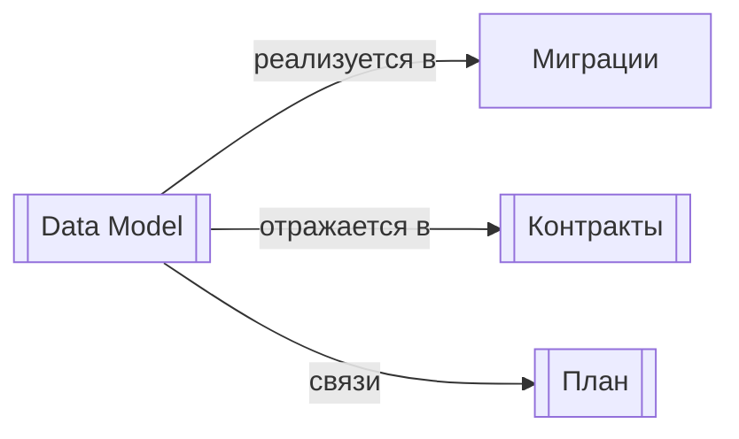

# Data Model

> [!info] Определение
> Схема данных фичи: сущности, поля, связи, ограничения. Сопутствующий артефакт
> [[План|плана]] в [[GitHub Spec Kit]]. См. [[Контракты]], [[План]].

## Стандарт / источник

- [[GitHub Spec Kit]]: `specs/NNN-short-name/data-model.md`
- [[Kiro]]: раздел Data Models в `design.md`
- Классика: ER-диаграммы, [[IEEE 830]] §3 (logical database requirements)

## Формат

| Аспект | Значение |
|---|---|
| Имя | `data-model.md` |
| Синтаксис | Markdown + Mermaid ER-диаграммы |
| Содержимое | Сущности, поля, типы, связи, индексы, ограничения |

## Содержание

1. ER-диаграмма (Mermaid `erDiagram`)
2. Определения таблиц/сущностей: поля, типы, nullable, уникальность
3. Связи и кардинальности
4. Индексы и производительность
5. Миграции и откат

## Пример

```markdown
## Сущности

### users
| Поле | Тип | Ограничения |
|---|---|---|
| id | UUID PK | |
| email | TEXT | UNIQUE, NOT NULL |
| created_at | TIMESTAMPTZ | NOT NULL |

### orders
| Поле | Тип | Ограничения |
|---|---|---|
| id | UUID PK | |
| user_id | UUID FK → users.id | NOT NULL |
| total_cents | BIGINT | ≥ 0 |


```

## Диаграмма



## Мнемоника

**«Сущности, Поля, Связи, Индексы, Миграции»** — СПСИМ.

## Связи

- [[План]] · [[Контракты]] · [[Задачи]] · [[Спецификация]]

## Типичные ошибки

> [!warning]
> Деньги во float вместо целых минимальных единиц; отсутствие миграций с откатом.
