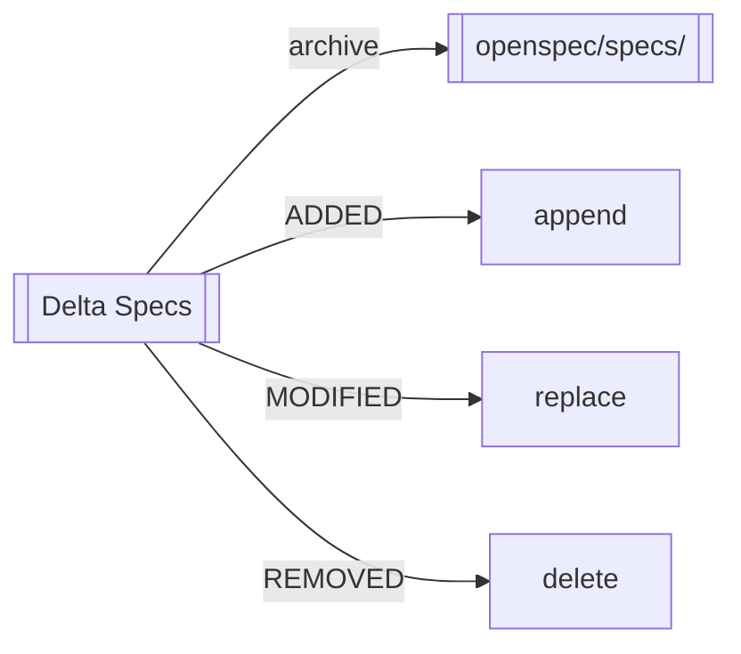

# Delta Specs

> [!info] Определение
> Описание изменений требований относительно текущего состояния системы:
> ADDED / MODIFIED / REMOVED / RENAMED. Ключевая сущность [[OpenSpec]] для brownfield.
> См. [[Proposal]], [[Спецификация]].

## Стандарт / источник

- [[OpenSpec]]: `openspec/changes/<name>/specs/<domain>/spec.md`
- При архивировании (`/opsx:archive`): ADDED добавляются, MODIFIED заменяют полные
  версии, REMOVED удаляются; папка уходит в `changes/archive/<date>-<name>/`.

## Формат

| Аспект | Значение |
|---|---|
| Имя | `specs/<domain>/spec.md` внутри папки изменения |
| Синтаксис | Markdown, секции-маркеры |
| Сценарии | [[Сценарии приёмки]] внутри каждого требования |

## Секции

- `## ADDED Requirements` — новое поведение
- `## MODIFIED Requirements` — полная новая версия требования (не фрагмент!)
- `## REMOVED Requirements` — удаляемое поведение + причина
- `## RENAMED Requirements` — переименования

## Пример

```markdown
# Delta for Auth

## ADDED Requirements
### Requirement: Two-Factor Authentication
The system MUST require a second factor during login.
#### Scenario: OTP required
- GIVEN a user with 2FA enabled
- WHEN the user submits valid credentials
- THEN an OTP challenge is presented

## MODIFIED Requirements
### Requirement: Session Timeout
The system SHALL expire sessions after 30 minutes of inactivity.
(Previously: 60 minutes)

## REMOVED Requirements
### Requirement: Remember Me
(Deprecated in favor of 2FA)
```

## Диаграмма



## Мнемоника

**«Добавили, Изменили, Удалили, Переименовали»** — ДИУП.

## Связи

- [[Proposal]] · [[Спецификация]] · [[Сценарии приёмки]] · [[OpenSpec]] · [[Задачи]]

## Типичные ошибки

> [!warning]
> MODIFIED как фрагмент вместо полной версии требования: archive заменит требование
> на фрагмент. Новое поведение, помеченное как ADDED при существующем требовании, —
> дублирование.
