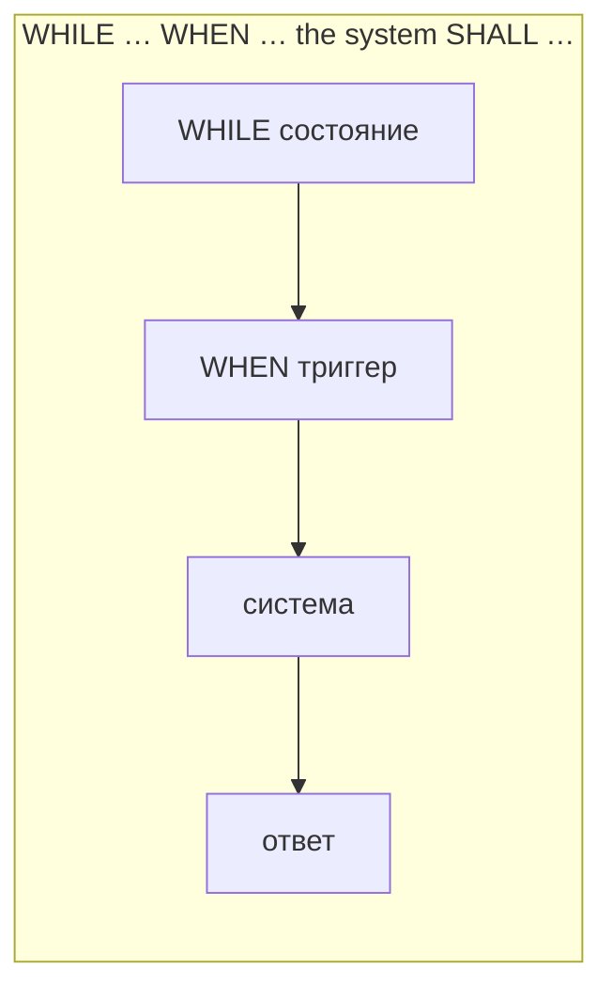

# EARS-требования

> [!info] Определение
> Нотация требований Rolls-Royce (Mavin et al., IEEE RE'09): фиксированный порядок
> клауз, один субъект и один триггер на требование. Нотация требований в [[Kiro]].
> См. [[Требования]], [[RFC 2119]].

## Стандарт / источник

- Alistair Mavin и коллеги, Rolls-Royce, 2009. Поддержана INCOSE RWG.
- Сила слова — [[RFC 2119]] (SHALL/MUST).

## Формат

```
WHILE <предусловие>, WHEN <триггер>, the <система> SHALL <ответ>
```

## Пять паттернов

| Паттерн | Ключевое слово | Пример |
|---|---|---|
| Ubiquitous | — | The checkout page shall display prices in store currency. |
| Event-driven | WHEN | WHEN user applies SAVE10 to 50.00 cart, checkout SHALL show 45.00. |
| State-driven | WHILE | WHILE cart is empty, checkout SHALL disable Pay button. |
| Unwanted behaviour | IF…THEN | IF payment declined, THEN checkout SHALL show «Payment declined». |
| Optional feature | WHERE | WHERE gift wrap enabled, checkout SHALL show gift-wrap option. |

## Правила

- 0+ предусловий, 0–1 триггер, ровно 1 имя системы, 1+ отклик.
- Ответ наблюдаем: сообщение, значение, страница, состояние.
- Одно поведение на SHALL — иначе разделить.

## Диаграмма



## Мнемоника

**«Всегда Когда Пока Если Где»** — ВКПЕГ (Ubiquitous, Event, State, Unwanted, Optional).

## Связи

- [[Требования]] · [[Сценарии приёмки]] · [[Kiro]] · [[RFC 2119]] · [[INCOSE Guide]]

## Типичные ошибки

> [!warning]
> «The system should validate email» — SHOULD вместо SHALL; «система использует Redis» —
> реализация вместо поведения.
