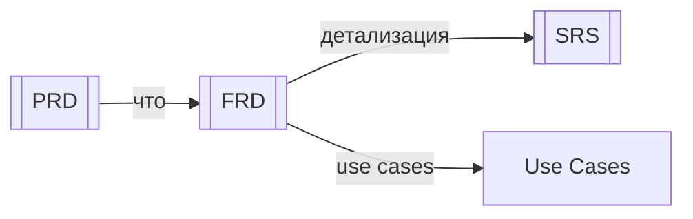

# FRD (Functional Requirements Document)

> [!info] Определение
> Функциональные требования: как система ведёт себя на уровне экранов, правил,
> входов/выходов. Технический уровень между [[PRD]] и [[SRS]]. См. [[Требования]].

## Стандарт / источник

- Enterprise IT, агентства, аутсорсинг; автор — бизнес/системный аналитик.
- Читатели: разработчики, QA, архитекторы.

## Формат

| Аспект | Значение |
|---|---|
| Длина | 10–30+ страниц |
| Уровень | Технический, гранулярный |
| Метрики | SLA, времена отклика |

## Содержание

1. Introduction
2. Business Requirements (контекст из PRD)
3. Functional Features
4. User Roles & Permissions
5. Use Cases
6. System Behavior (правила, валидации, error states)
7. Process Diagrams / Data Flow
8. Non-Functional Requirements
9. Assumptions & Constraints

## Пример

```markdown
# FRD: Фильтр товаров по цене

## Поведение
- Элемент: dropdown «Цена» на странице каталога.
- Диапазон: min 0, max 100 000; по умолчанию — последние 30 дней.
- Если start > end: показать ошибку «Некорректный диапазон».
- API: GET /products?price_min=X&price_max=Y; кэш 5 минут.
```

## Диаграмма



## Мнемоника

**«Функции, Роли, Сценарии, Поведение, Диаграммы, NFR»** — ФРСПДН.

## Связи

- [[PRD]] · [[BRD]] · [[SRS]] · [[Требования]] · [[Спецификация]]

## Типичные ошибки

> [!warning]
> FRD как пересказ PRD: FRD должен специфицировать поведение на уровне,
> достаточном для реализации и тестирования.
