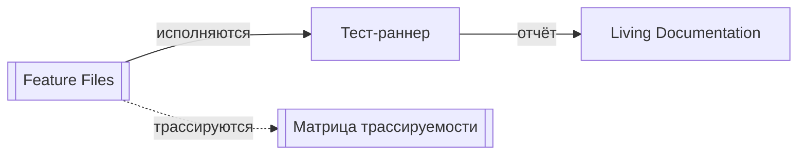

# Feature Files

> [!info] Определение
> Файлы `.feature` со сценариями [[Сценарии приёмки|Gherkin]]: исполняемые спеки,
> которые одновременно являются тестами и живой документацией. См. [[Сценарии приёмки]].

## Стандарт / источник

- **Gherkin** (Cucumber, ~2008); раннеры: Cucumber, SpecFlow, Behave, Reqnroll, Karate.
- Отчёты living documentation: Pickles, SpecFlow+ LivingDoc, Halo Reporting.

## Формат

| Аспект | Значение |
|---|---|
| Расширение | `.feature` |
| Структура | Feature → Background → Scenario / Scenario Outline → Examples |
| Связь с кодом | Step definitions (шаги → код тестов) |

## Содержание

1. Feature: название + «Как…, я хочу…, чтобы…»
2. Background: общий контекст
3. Scenario: Given/When/Then
4. Scenario Outline + Examples: параметризованные примеры

## Пример

```gherkin
Feature: Промокоды
  Как покупатель, я хочу применять промокоды, чтобы платить меньше

  Background:
    Given a cart totalling 50.00

  Scenario: SAVE10 даёт скидку 10%
    When the user applies code "SAVE10"
    Then the order total shows "45.00"

  Scenario Outline: Невалидный код
    When the user applies code "<code>"
    Then the total remains "50.00"
    And an error "Invalid code" is shown

    Examples:
      | code    |
      | EXPIRED |
      | UNKNOWN |
```

## Диаграмма



## Мнемоника

**«Фича, Фон, Сценарий, Примеры»** — ФФСП.

## Связи

- [[Сценарии приёмки]] · [[EARS-требования]] · [[Спецификация]] · [[Матрица трассируемости]]

## Типичные ошибки

> [!warning]
> Императивные шаги («click button X») — хрупкие тесты. Сквозные браузерные тесты
> для доменной логики — медленные.
