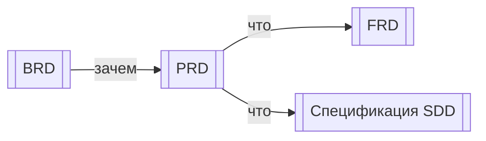

# PRD (Product Requirements Document)

> [!info] Определение
> Документ «что строим и для кого»: проблема, пользователи, цели, scope, метрики.
> Тактический уровень между [[BRD]] (зачем) и [[FRD]] (как). См. [[Спецификация]].

## Стандарт / источник

- Шаблон Atlassian (8 секций); в [[BMAD]] — артефакт агента Product.
- В продуктовых компаниях PRD часто поглощает BRD (бизнес-кейс — в секциях goals/background).

## Формат

| Аспект | Значение |
|---|---|
| Синтаксис | Markdown / Google Docs / Confluence |
| Длина | 1–15 страниц |
| Автор | Product Manager |
| Читатели | Дизайн, разработка, QA, руководство |

## Содержание (Atlassian, 8 секций)

1. Участники, статус, целевой релиз
2. Проблема и фон (с доказательствами, до фич)
3. Пользователи и цели
4. Не-цели (что сознательно исключено)
5. Требования (проверяемые, без «быстро»/«просто»)
6. Метрики успеха (+ guard rails)
7. Допущения и риски
8. Открытые вопросы

## Пример

```markdown
# PRD: Повторный заказ в 1 тап

## Проблема
Возвращающиеся клиенты перепечатывают один и тот же заказ каждую неделю
(подтверждено тикетами поддержки).

## Пользователи и цели
Клиенты, заказывающие еженедельно; цель — меньше тапов на повтор заказа.

## Не-цели
Запланированные заказы, подписки, групповые заказы.

## Требования
- Кнопка «повторить» для заказов за последние 30 дней.
- Предупреждение перед оплатой, если товар недоступен.

## Метрики успеха
Доля повторных заказов через кнопку; guard rails: отмены, тикеты.
```

## Диаграмма



## Мнемоника

**«Участники, Проблема, Пользователи, Не-цели, Требования, Метрики, Допущения, Вопросы»** — УППНТМДВ.

## Связи

- [[BRD]] · [[FRD]] · [[Спецификация]] · [[Пользовательские истории]] · [[SRS]]

## Типичные ошибки

> [!warning]
> PRD на изменение, которое один разработчик шипнет за день: достаточно короткого брифа.
> Требования без измеримости («быстро», «просто»).
