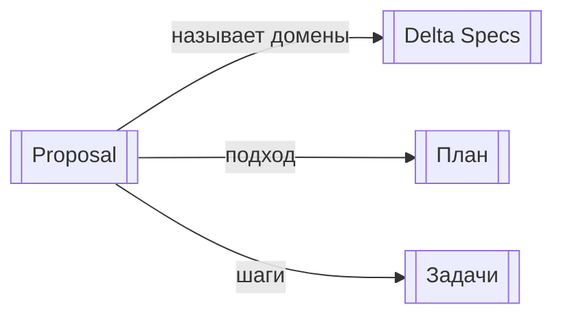

# Proposal

> [!info] Определение
> «Почему и что» изменения: намерение, область, подход, влияние. Сущность [[OpenSpec]],
> отсутствующая в [[GitHub Spec Kit]] и [[Kiro]]. См. [[Delta Specs]], [[Спецификация]].

## Стандарт / источник

- [[OpenSpec]]: `openspec/changes/<change-name>/proposal.md`, команда `/opsx:propose`

## Формат

| Аспект | Значение |
|---|---|
| Имя | `proposal.md` |
| Синтаксис | Markdown |
| Роль | Контракт для этапа дельт: какие домены затрагиваются |

## Содержание

1. **Intent** — зачем существует изменение
2. **Scope** — что входит
3. **Out of Scope** — что не входит
4. **Approach** — технический подход в общих чертах
5. **Impact** — затронутые домены, миграции, совместимость

## Пример

```markdown
# Proposal: Add Dark Mode

## Intent
Пользователи просят тёмную тему для ночного использования.

## Scope
- Переключатель темы в настройках
- Детект системных предпочтений
- Сохранение в localStorage

## Out of Scope
- Пользовательские темы
- Тёмная тема для PDF-экспорта

## Approach
CSS custom properties + React context.

## Impact
- Домен: ui
- Миграций нет
```

## Диаграмма



## Мнемоника

**«Намерение, Область, Вне области, Подход, Влияние»** — НОВВП.

## Связи

- [[Delta Specs]] · [[План]] · [[Задачи]] · [[Спецификация]] · [[OpenSpec]]

## Типичные ошибки

> [!warning]
> Proposal без Out of Scope: scope creep начинается на ревью.
