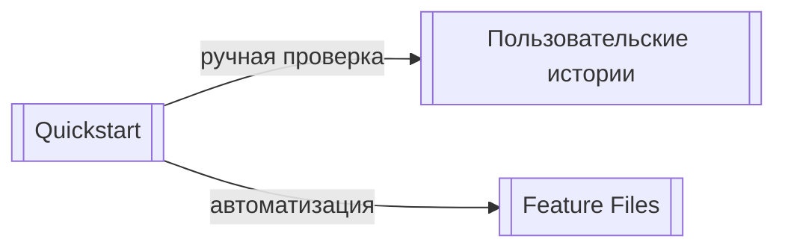

# Quickstart

> [!info] Определение
> Ключевые сценарии валидации для ручного тестирования фичи: шаги, ожидаемые результаты.
> Сопутствующий артефакт [[GitHub Spec Kit]]. См. [[План]], [[Сценарии приёмки]].

## Стандарт / источник

- [[GitHub Spec Kit]]: `specs/NNN-short-name/quickstart.md`

## Формат

| Аспект | Значение |
|---|---|
| Имя | `quickstart.md` |
| Синтаксис | Markdown, нумерованные сценарии |
| Содержимое | Setup + сценарии + ожидаемые результаты |

## Содержание

1. Подготовка окружения (команды запуска)
2. Сценарии валидации по числу пользовательских историй
3. Ожидаемые результаты каждого шага
4. Критерии «готово к merge»

## Пример

```markdown
# Quickstart: Авторизация через OAuth

## Setup
```bash
go run ./cmd/server
```

## Сценарий 1: Вход через GitHub
1. Открыть http://localhost:8080/login
2. Нажать «Sign In with GitHub»
3. Ожидается: редирект на github.com/oauth/authorize
4. После подтверждения — возврат на /dashboard

## Сценарий 2: Неверный state
1. Подделать state в callback URL
2. Ожидается: HTTP 403, запись в лог
```

## Диаграмма



## Мнемоника

**«Запуск, Сценарии, Ожидания»** — ЗСО.

## Связи

- [[План]] · [[Спецификация]] · [[Сценарии приёмки]] · [[Feature Files]]

## Типичные ошибки

> [!warning]
> Сценарии без ожидаемых результатов: ручной тест превращается в «похоже, работает».
