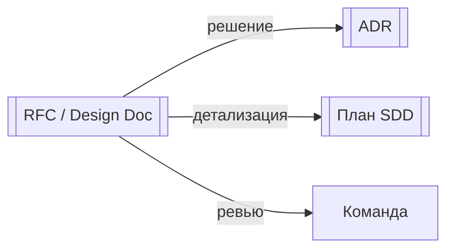

# RFC / Design Doc

> [!info] Определение
> Предложение дизайна с ревью-сообществом: контекст, дизайн, альтернативы, rollout.
> Инструмент консенсуса до кода (Google, Amazon, Uber, Rust). См. [[ADR]], [[План]].

## Стандарт / источник

- **Google Design Doc**: context, goals/non-goals, design, alternatives, cross-cutting concerns.
- **RFC-процесс**: IETF, Rust, Uber — proposal → discussion → accepted.
- Amazon: «working backwards», 6-pager; Stripe/Slack: tech spec.

## Формат

| Аспект | Значение |
|---|---|
| Длина | RFC 2–10 стр.; Design Doc 5–20 стр. |
| Статусы | Draft → In Review → Accepted/Rejected (RFC); Draft → In Review → Approved (Design Doc) |
| Аудитория | RFC — вся организация; Design Doc — команда реализации |

## Содержание (Google Style)

1. Метаданные: авторы, ревьюеры, статус, дата
2. Overview / TL;DR (1 абзац)
3. Context / Background (с реальными цифрами)
4. Goals and Non-Goals
5. Detailed Design: архитектура, API, [[Data Model]], обработка ошибок
6. Alternatives Considered
7. Cross-Cutting Concerns: безопасность, приватность, наблюдаемость
8. Migration / Rollout Plan (+ rollback)
9. Open Questions
10. Appendix

## Пример (фрагмент)

```markdown
# RFC: Rate Limiting на API Gateway

- Author: ...
- Status: In Review
- Date: 2026-11-01

## Context
Один клиентский retry loop замедлил checkout для всех
(инцидент 2026-10-28, p99 +2.4с).

## Goals / Non-Goals
Goal: ограничить 1000 req/min на ключ. Non-goal: per-user квоты (следующий RFC).

## Alternatives Considered
- Token bucket в Redis: выбран.
- Fixed window в памяти: отклонён — нет координации между инстансами.

## Rollout Plan
Фаза 1: shadow mode. Фаза 2: 5% трафика. Rollback: feature flag.
```

## Диаграмма



## Мнемоника

**«Контекст, Цели, Дизайн, Альтернативы, Сквозные, Развёртывание, Вопросы»** — КЦДАСРВ.

## Связи

- [[ADR]] · [[План]] · [[Data Model]] · [[Контракты]] · [[Спецификация]]

## Типичные ошибки

> [!warning]
> Design Doc без альтернатив («просто сделаем так») — главный failure mode.
> Если бы документ только говорил «как строить» и никто бы не спорил — пропустить
> документ и писать код.
