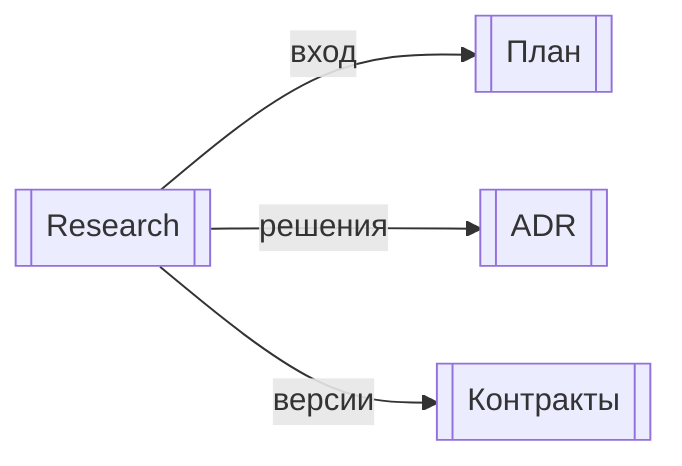

# Research

> [!info] Определение
> Запись исследования технологий для [[План|плана]]: версии, совместимость, альтернативы.
> Сопутствующий артефакт [[GitHub Spec Kit]]. См. [[План]], [[ADR]].

## Стандарт / источник

- [[GitHub Spec Kit]]: `specs/NNN-short-name/research.md` (генерируется на фазе plan)

## Формат

| Аспект | Значение |
|---|---|
| Имя | `research.md` |
| Синтаксис | Markdown |
| Содержимое | Решения по технологиям с обоснованием |

## Содержание

1. Выбранные библиотеки/сервисы + версии (зафиксированы)
2. Совместимость версий
3. Рассмотренные альтернативы и почему отклонены
4. Риски (поддержка, лицензии, supply chain)

## Пример

```markdown
# Research: Авторизация через OAuth

## Решение: golang.org/x/oauth2 v0.24.0
- Официальный пакет, поддерживается Go team.
- Совместим с Go 1.23.

## Альтернативы
- keycloak/goclo — тяжелее, нужен отдельный сервер.
- Самописный flow — риск ошибок безопасности.

## Риски
- Лицензия BSD-3 — OK.
```

## Диаграмма



## Мнемоника

**«Выбор, Версии, Альтернативы, Риски»** — ВВАР.

## Связи

- [[План]] · [[ADR]] · [[Контракты]] · [[Задачи]]

## Типичные ошибки

> [!warning]
> Незафиксированные версии («последняя») — невоспроизводимые сборки.
