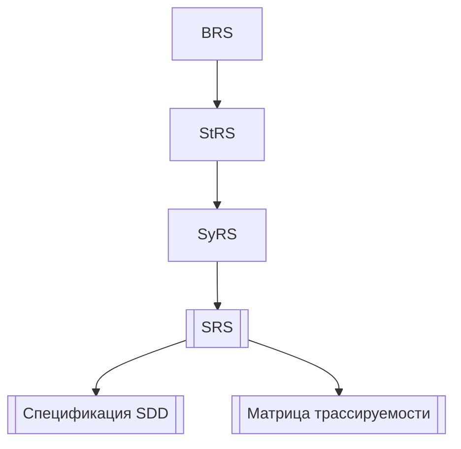

# SRS (Software Requirements Specification)

> [!info] Определение
> Спецификация требований к ПО: что система делает и как хорошо. Классический документ
> по [[IEEE 830]] и [[ISO 29148]]. Предок [[Спецификация|спеки SDD]]. См. [[Требования]].

## Стандарт / источник

- [[IEEE 830-1998]]: структура из 3 разделов; заменён [[ISO 29148]] (2011/2018).
- [[ISO 29148]]: BRS → StRS → SyRS → SRS (уровни детализации).

## Формат

| Аспект | Значение |
|---|---|
| Структура | 1. Introduction, 2. Overall Description, 3. Specific Requirements, 4. Appendices |
| Объём §3 | 60–70% документа |
| Атрибуты требования | Id, Priority, Rationale, Verification Method |

## Содержание §3 (Specific Requirements)

- 3.1 External Interface Requirements (UI, hardware, software, communications)
- 3.2 Functional Requirements
- 3.3 Performance Requirements
- 3.4 Design Constraints
- 3.5 Software System Attributes
- 3.6 Other Requirements

## Пример

```markdown
## 3.2 Functional Requirements
- SRS-1: The system shall generate a monthly sales report in PDF format
  when the user clicks Export. (Verification: Test)

## 3.3 Performance Requirements
- SRS-2: The system shall respond to any query within 2 seconds
  under normal load. (Verification: Test)
```

## Диаграмма



## Мнемоника

8 характеристик качества: **КОПС-РВМТ** — Корректность, Однозначность, Полнота,
Согласованность, Ранжирование, Верифицируемость, Модифицируемость, Трассируемость.

## Связи

- [[IEEE 830]] · [[ISO 29148]] · [[Требования]] · [[Спецификация]] · [[Матрица трассируемости]] · [[ТЗ по ГОСТ 19]]

## Типичные ошибки

> [!warning]
> Отсутствие NFR — самая частая причина провалов SRS. «Быстро» без чисел
> неверифицируемо.
