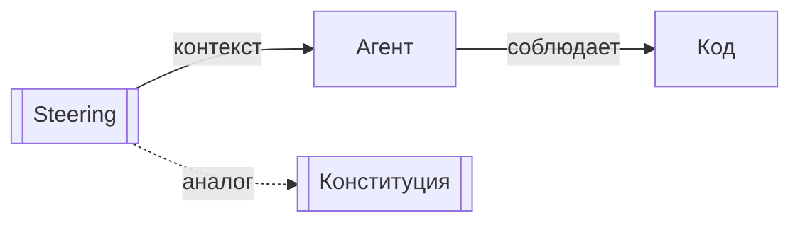

# Steering

> [!info] Определение
> Долгосрочный контекст проекта в [[Kiro]]: стек, стандарты, структура.
> Аналог [[Конституция|конституции]] Spec Kit. См. [[Инструкционные файлы агентов]].

## Стандарт / источник

- [[Kiro]]: `.kiro/steering/` — Markdown-файлы, читаемые агентом каждую сессию.
- Также читается `AGENTS.md`.

## Формат

| Аспект | Значение |
|---|---|
| Расположение | `.kiro/steering/` |
| Синтаксис | Markdown |
| Содержимое | Стек, конвенции, структура, границы |

## Содержание

1. Обзор проекта и стека
2. Стандарты кодирования
3. Структура репозитория
4. Ограничения и запреты
5. Ссылки на [[ADR]] и документацию

## Пример

```markdown
# Steering: Стек проекта

## Технологии
- Backend: Go 1.23, net/http
- БД: PostgreSQL 16
- Кэш: Redis 7

## Конвенции
- Ошибки — через Result-паттерн, не panic
- Деньги — в центах (BIGINT)

## Границы
- Не модифицировать миграции без approval
- Не добавлять зависимости без ревью
```

## Диаграмма



## Мнемоника

**«Стек, Стандарты, Структура, Границы»** — СССГ.

## Связи

- [[Конституция]] · [[Инструкционные файлы агентов]] · [[ADR]] · [[Kiro]]

## Типичные ошибки

> [!warning]
> Steering как свалка: только то, что агент не выведет из кода.
> Дублирование AGENTS.md: один источник истины.
