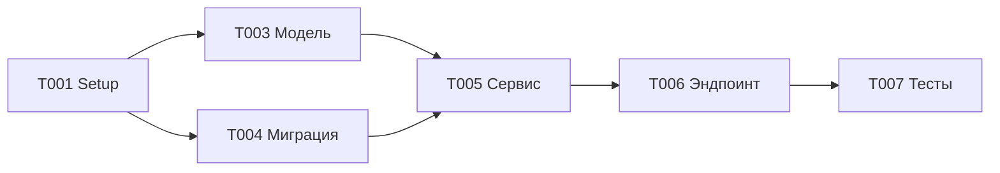

# Задачи (Tasks)

> [!info] Определение
> Декомпозиция плана в атомарные, упорядоченные по зависимостям шаги.
> Исполняется агентом по порядку; каждая задача трассируется к требованию.
> См. [[План]], [[Матрица трассируемости]].

## Стандарт / источник

- [[GitHub Spec Kit]]: `specs/NNN-short-name/tasks.md`
- [[Kiro]]: `.kiro/specs/<name>/tasks.md` — граф зависимостей, параллельные «волны»
- [[OpenSpec]]: `openspec/changes/<name>/tasks.md` — чек-лист с чекбоксами

## Формат файла

| Аспект | Значение |
|---|---|
| Имя | `tasks.md` |
| Синтаксис | Markdown, чекбоксы |
| ID | T001, T002, … |
| Маркер параллелизации | `[P]` — независимая задача |
| Трассировка | Ссылка на FR-XXX / USn |

## Содержание

- Фазы: Setup → Foundational → User Stories → Polish
- 10–20 микро-задач на фичу; каждая ≈ один коммит или изменение файла
- Точный путь файла в каждой задаче

## Пример

```markdown
# Задачи: Авторизация через OAuth

## Фаза 1: Настройка
- [ ] T001 [P] Создать структуру `src/auth/`
- [ ] T002 Установить зависимости: `go get github.com/oauth2/...`

## Фаза 2: Фундамент
- [ ] T003 [P] Модель пользователя `src/auth/user.go` (FR-001)
- [ ] T004 Миграция БД `migrations/001_users.sql` (FR-001)

## Фаза 3: US1
- [ ] T005 Сервис `src/auth/github.go` (FR-001, US1)
- [ ] T006 Эндпоинт `GET /auth/github/callback` (FR-002, US1)
- [ ] T007 Тесты `tests/auth_test.go` (US1)

**Легенда**: `[P]` — параллельная задача.
```

## Диаграмма



## Мнемоника

**«Фаза, ID, Путь, Требование»** — ФИПР: четыре элемента задачи.

## Связи

- [[План]] · [[Спецификация]] · [[Матрица трассируемости]] · [[Чек-листы]]

## Типичные ошибки

> [!warning]
> Задачи без трассировки к требованиям: нельзя проверить покрытие.
> Слишком крупные задачи («реализовать авторизацию») — агент теряет контекст.
