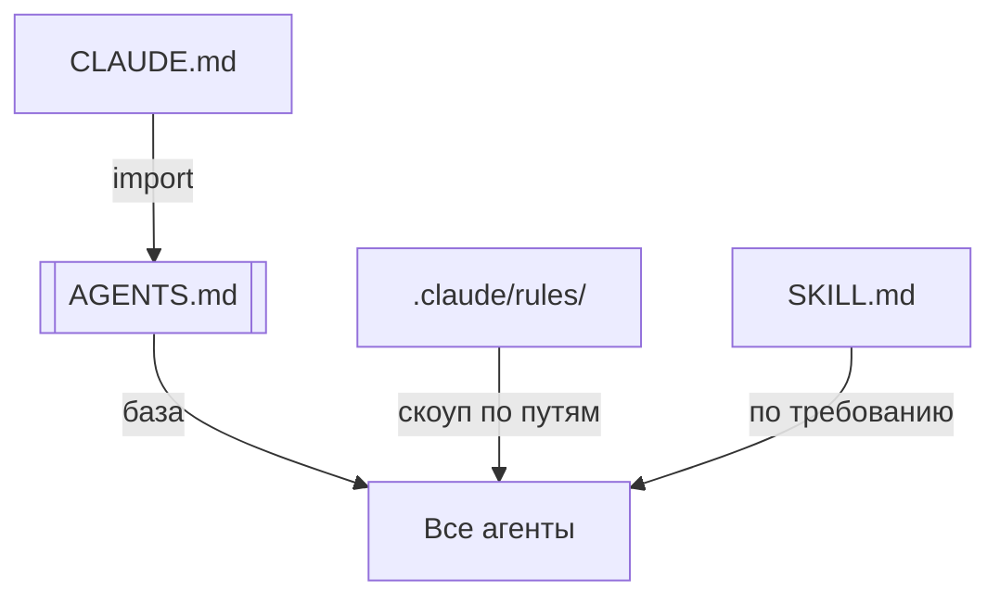

# Инструкционные файлы агентов

> [!info] Определение
> Постоянные инструкции проекта для AI-агентов: команды, конвенции, границы.
> Формат-агностик, версионируется в Git. См. [[Конституция]], [[Steering]].

## Стандарт / источник

- **AGENTS.md** — стандарт 2026: читается Claude Code, Codex CLI, Cursor, Aider,
  Devin, Copilot, Gemini CLI, Windsurf, Amazon Q.
- **CLAUDE.md** — нативный формат Claude Code; `@AGENTS.md` import или symlink.
- **.cursor/rules/*.mdc**, **.github/copilot-instructions.md** — инструмент-специфичные.

## Формат

| Аспект | Значение |
|---|---|
| Расположение | Корень репозитория (+ вложенные для monorepo) |
| Синтаксис | Markdown |
| Размер | < 150–200 строк (иначе падает adherence) |
| Лимит Codex | 32 KiB на цепочку инструкций |

## Содержание

**Включать:** точные команды сборки/тестов; карта архитектуры; конвенции, отклоняющиеся
от дефолтов; ограничения; правила тестирования; антипаттерны с обоснованием.

**Не включать:** конвенции языка (работа линтера); «чистый код»; листинги файлов;
секреты; копии документов (только ссылки).

## Пример

```markdown
# AGENTS.md

## Команды
- Install: pnpm install
- Test: pnpm test
- Lint: pnpm lint

## Конвенции
- Ошибки — Result-паттерн (см. src/utils/result.ts)
- Не модифицировать миграции без approval

## Указатели
- Решения по бронированию: docs/adr/ (тег booking)
- Спеки домена: openspec/specs/
```

## Диаграмма



## Мнемоника

**«Команды, Карта, Конвенции, Границы, Указатели»** — КККГУ.

## Связи

- [[Конституция]] · [[Steering]] · [[ADR]] · [[Workflow SDD]]

## Типичные ошибки

> [!warning]
> Файл > 200 строк: агент игнорирует середину («lost in the middle»).
> LLM-сгенерированные инструкции снижают успех агентов (исследование 2026, 138 репозиториев).
> «Должно всегда происходить» — в hooks, а не в инструкциях.
