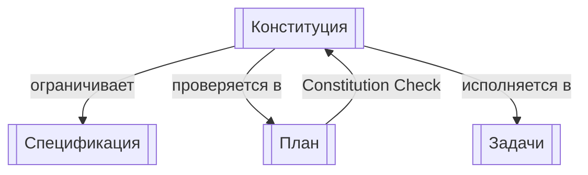

# Конституция

> [!info] Определение
> Неизменяемые принципы проекта, которые AI-агент обязан соблюдать на всех этапах SDD.
> Решает проблему потери нефункциональных требований (NFR) при AI-генерации.
> См. также [[Steering]], [[Инструкционные файлы агентов]], [[Workflow SDD]].

## Стандарт / источник

- Концепция GitHub [[GitHub Spec Kit]] (2025); аналоги: steering-файлы [[Kiro]],
  `AGENTS.md`/`CLAUDE.md` ([[Инструкционные файлы агентов]]).
- По духу — design constraints из [[IEEE 830]] §3.4.

## Формат файла

| Аспект | Значение |
|---|---|
| Имя | `constitution.md` |
| Расположение (Spec Kit) | `.specify/memory/constitution.md` |
| Расположение (Kiro) | `.kiro/steering/*.md` |
| Синтаксис | Markdown, статьи-принципы |
| Версионирование | SemVer; изменения — PR с обоснованием |

## Содержание

- 5–10 **проверяемых** правил: стиль кода, тесты, безопасность, производительность, запреты.
- Каждое правило — тестируемо («каждая миграция с откатом», а не «чистый код»).
- Процесс изменений: PR → ревью мейнтейнерами → bump версии.

## Пример

```markdown
# Конституция проекта

**Версия**: 1.0.0 | **Утверждена**: 2026-11-01

## Статья I. Качество кода
- Покрытие новых модулей ≥ 80%. Линт и typecheck в CI обязательны.

## Статья II. Безопасность
- Секреты — только через secret manager. Логи без сырых промптов и PII.

## Статья III. Архитектура
- Деньги — в целых минимальных единицах. Идемпотентные записи.
```

## Диаграмма



## Мнемоника

**«Стиль, Безопасность, Архитектура, API, Тесты»** — СБАТ: пять типов статей конституции.

## Связи

- [[Спецификация]] · [[План]] · [[Steering]] · [[Инструкционные файлы агентов]] · [[Чек-листы]]

## Типичные ошибки

> [!warning]
> Аспирационные правила, которым никто не следует: каждое ревью превращается в спор.
> Конституция описывает только уже принятые и соблюдаемые принципы.
