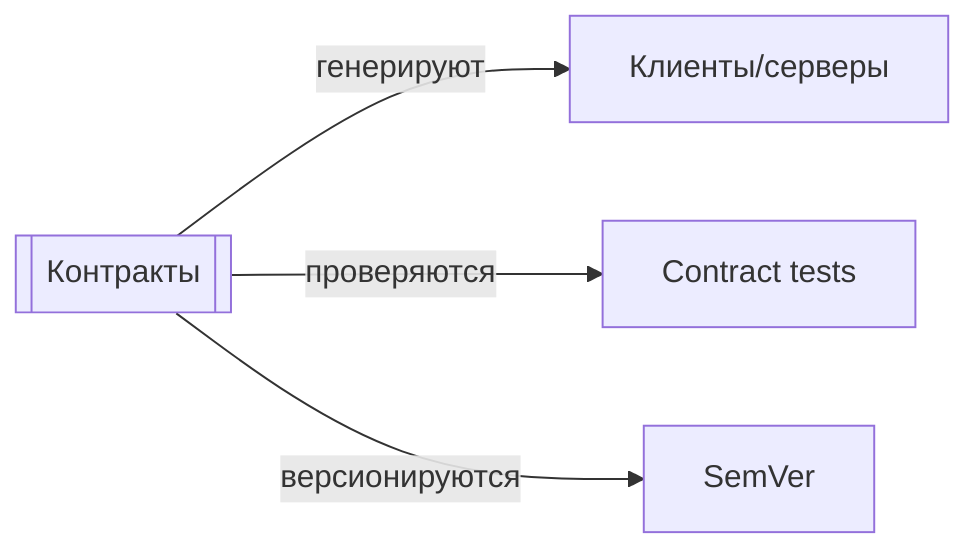

# Контракты (Contracts)

> [!info] Определение
> Машиночитаемые интерфейсы: эндпоинты, схемы запросов/ответов, события.
> Контракт — проверяемый источник истины для интеграций. См. [[План]], [[Data Model]].

## Стандарт / источник

- **OpenAPI** (OAS 3.x, Linux Foundation): YAML/JSON, `info`, `servers`, `paths`,
  `components/schemas`, `securitySchemes`.
- [[GitHub Spec Kit]]: `specs/NNN-short-name/contracts/api-spec.json`,
  `contracts/signalr-spec.md` (WebSocket-события).
- AsyncAPI — для событий; GraphQL SDL — для GraphQL.

## Формат

| Аспект | Значение |
|---|---|
| Имя | `api-spec.json` / `openapi.yaml` |
| Синтаксис | YAML/JSON (OpenAPI) |
| Версионирование | SemVer; breaking changes — major bump |

## Содержание OpenAPI

- `info`: title, version, contact, license (+ x-расширения: owner, SLA, deprecation)
- `servers`: prod/staging/local
- `paths`: операции, параметры, requestBody, responses
- `components/schemas`: переиспользуемые модели (JSON Schema)
- `securitySchemes`: API key, OAuth 2.0, OIDC, mTLS

## Пример

```yaml
openapi: "3.1.0"
info:
  title: Orders API
  version: "2.3.1"
paths:
  /orders:
    get:
      operationId: listOrders
      parameters:
        - name: customer_id
          in: query
          required: true
          schema: { type: string, format: uuid }
      responses:
        "200":
          description: Paginated list
          content:
            application/json:
              schema:
                $ref: "#/components/schemas/OrderListResponse"
```

## Диаграмма



## Мнемоника

**«Метаданные, Серверы, Пути, Схемы, Безопасность»** — МСПСБ: пять блоков OpenAPI.

## Связи

- [[План]] · [[Data Model]] · [[SDD в CI-CD]] · [[Задачи]]

## Типичные ошибки

> [!warning]
> Контракт без версионирования; breaking changes без major bump;
> enum, который не append-only.
