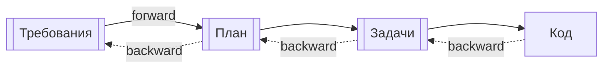

# Матрица трассируемости

> [!info] Определение
> Таблица соответствия требований ↔ дизайн ↔ задачи ↔ тесты ↔ код.
> Обеспечивает двунаправленную трассируемость SDD. См. [[Требования]], [[Задачи]].

## Стандарт / источник

- [[IEEE 830]]: traceability — одна из 8 характеристик качества SRS.
- [[ISO 29148]]: атрибуты требований, verification methods.
- В SDD: ссылки FR-XXX в tasks.md/design.md или отдельная таблица.

## Формат

| Аспект | Значение |
|---|---|
| Синтаксис | Markdown-таблица |
| Направления | Forward (требования→код) и Backward (код→требования) |

## Пример

| Требование | Дизайн | Задачи | Тесты | Код |
|---|---|---|---|---|
| FR-001 (логин) | plan.md §Архитектура | T005, T006 | tests/auth.test.js | src/services/AuthService.js |
| FR-002 (2FA) | design.md §Interfaces | T008 | tests/2fa.test.js | src/services/TwoFactor.js |
| NFR-001 (≤200 мс) | plan.md §Контекст | T010 | tests/perf/ | src/api/… |

## Методы верификации (ISO 29148)

| Метод | Когда |
|---|---|
| Test | Поведение выполняется и наблюдается |
| Demonstration | Функция показывается |
| Inspection | Проверка артефакта без исполнения |
| Analysis | Расчёт, моделирование |

## Диаграмма

## Мнемоника

**«Тест, Демо, Инспекция, Анализ»** — ТДИА (методы верификации).

## Связи

- [[Требования]] · [[Задачи]] · [[План]] · [[SRS]] · [[Чек-листы]]

## Типичные ошибки

> [!warning]
> Требование без задачи и теста — непокрыто. Код без требования — «лишний» код.
> Требование без метода верификации — пожелание.
