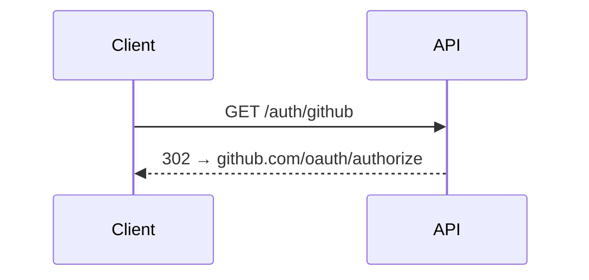
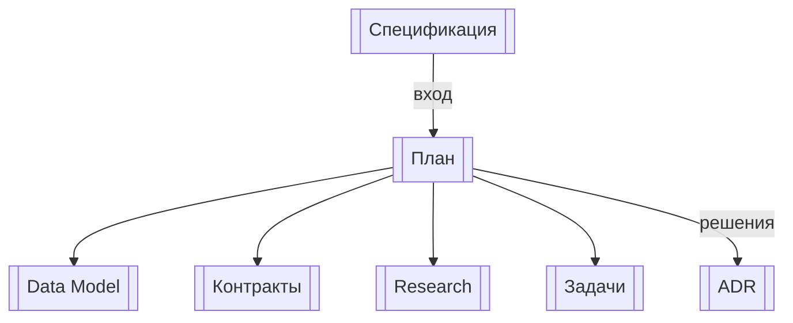

# План (Plan / Design)

> [!info] Определение
> Технический чертёж: КАК реализуем требования. Переводит бизнес-требования
> в архитектуру, стек, модель данных и контракты. См. [[Спецификация]], [[Data Model]],
> [[Контракты]], [[ADR]].

## Стандарт / источник

- [[GitHub Spec Kit]]: `specs/NNN-short-name/plan.md` + сопутствующие файлы
- [[Kiro]]: `.kiro/specs/<name>/design.md` — 6 разделов: Architecture, Data Flow,
  Interfaces, Data Models, Error Handling, Unit Testing Strategy
- [[OpenSpec]]: `openspec/changes/<name>/design.md` (опционально)
- Классика: [[RFC Design Doc]], [[IEEE 1016]] (software design descriptions)

## Формат файла

| Аспект | Значение |
|---|---|
| Имя | `plan.md` / `design.md` |
| Синтаксис | Markdown + Mermaid-диаграммы |
| Сопутствующие | [[Data Model]], [[Контракты]], [[Research]], [[Quickstart]] |
| Обязательная секция | Constitution Check |

## Содержание

1. Технический контекст: язык, фреймворк, зависимости (версии зафиксированы)
2. Архитектура: компоненты, поток запросов, диаграммы
3. Ключевые решения и обоснование (ссылки на [[Конституция]] и [[ADR]])
4. **Constitution Check** — явная проверка на соответствие принципам
5. Порядок создания файлов

## Пример

```markdown
# План: Авторизация через OAuth

## Технический контекст
- Go 1.23, net/http; Redis для сессий; PostgreSQL для пользователей.

## Архитектура


## Constitution Check
- [x] Секреты через secret manager — соблюдено
- [x] Timeout на внешние вызовы — 5s на GitHub API
```

## Диаграмма



## Мнемоника

**«Стек, Архитектура, Решения, Проверка, Порядок»** — САРПП: пять секций плана.

## Связи

- [[Спецификация]] · [[Задачи]] · [[Data Model]] · [[Контракты]] · [[Research]] · [[Quickstart]] · [[ADR]] · [[Стандарты описания флоу]]

## Типичные ошибки

> [!warning]
> План без Constitution Check: агент дрейфует к дефолтным решениям модели.
> План, переписывающий спеку: план отвечает «как», а не «что».
