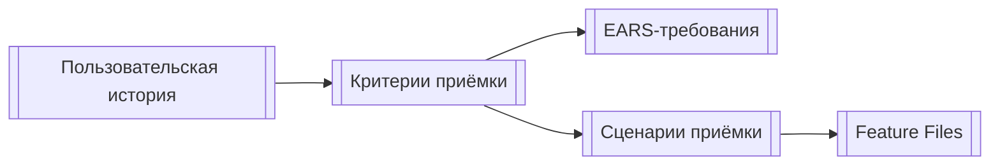

# Пользовательские истории (User Stories)

> [!info] Определение
> Короткие описания потребности пользователя в формате «Как…, я хочу…, чтобы…».
> Единица приоритезации и планирования в [[Спецификация|спеке]]. См. [[Требования]],
> [[Сценарии приёмки]].

## Стандарт / источник

- Agile/Scrum; критерии качества **INVEST**: Independent, Negotiable, Valuable,
  Estimable, Small, Testable.
- В [[GitHub Spec Kit]]: истории с приоритетами P1/P2/P3 в `spec.md`.
- В [[Kiro]]: истории в `requirements.md` + критерии в [[EARS-требования|EARS]].

## Формат

```markdown
### US1 — [Название] (Приоритет: P1)
Как [роль], я хочу [цель], чтобы [польза].

Критерии приёмки:
1. Given …, When …, Then …
```

## Пример

```markdown
### US1 — Вход через GitHub (P1)
Как разработчик, я хочу войти через GitHub OAuth, чтобы мои репозитории были связаны.

Критерии приёмки:
1. Given страница входа, When нажата «Sign In with GitHub», Then редирект на OAuth.
2. Given неверный state, When callback, Then отказ с HTTP 403.
```

## Диаграмма



## Мнемоника

**INVEST** — «Независима, Переговорна, Ценна, Оцениваема, Мала, Тестируема».

## Связи

- [[Спецификация]] · [[Требования]] · [[EARS-требования]] · [[Сценарии приёмки]] · [[Задачи]]

## Типичные ошибки

> [!warning]
> История без критериев приёмки двусмысленна: дополняйте EARS-требованиями
> или Gherkin-сценариями.
