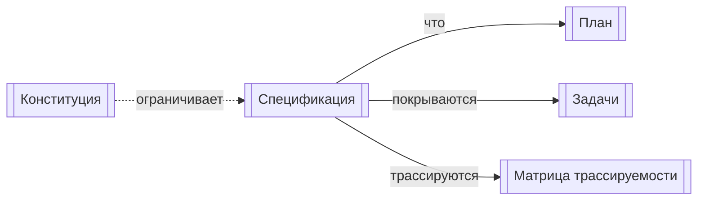

# Спецификация (Spec)

> [!info] Определение
> Документ «что и зачем»: поведение фичи без деталей реализации. Изоляция требований
> от дизайна — принцип чистоты архитектурных решений. См. [[Требования]],
> [[Пользовательские истории]], [[Сценарии приёмки]].

## Стандарт / источник

- [[GitHub Spec Kit]]: `specs/NNN-short-name/spec.md`
- [[Kiro]]: `.kiro/specs/<name>/requirements.md` (для багов — `bugfix.md`)
- [[OpenSpec]]: `openspec/specs/<domain>/spec.md` + дельты ([[Delta Specs]])
- Классика: [[SRS]] по [[IEEE 830]] / [[ISO 29148]]

## Формат файла

| Аспект | Значение |
|---|---|
| Имя | `spec.md` / `requirements.md` |
| Синтаксис | Markdown |
| Нотация требований | [[EARS-требования]] или свободный Markdown |
| Сценарии | [[Сценарии приёмки]] (Given/When/Then) |
| Жизненный цикл | После утверждения — immutable; изменения только аддитивные |

## Содержание

1. Обзор (что и зачем, без реализации)
2. [[Пользовательские истории]] с приоритетами P1/P2/P3
3. Функциональные требования (FR)
4. Нефункциональные требования (NFR) — с измеримыми целями
5. [[Сценарии приёмки]]
6. Критерии успеха (измеримые, вне реализации)
7. Out of Scope
8. Открытые вопросы (фаза clarify)

## Пример

```markdown
# Спецификация: Авторизация через OAuth

## Пользовательские истории
### US1 — Вход через GitHub (P1)
Как разработчик, я хочу войти через GitHub OAuth, чтобы мои репозитории были связаны.

**Критерии приёмки:**
1. Given страница входа, When пользователь нажимает «Sign In with GitHub»,
   Then происходит редирект на OAuth-эндпоинт GitHub.

## Функциональные требования
- FR-001: WHEN пользователь нажимает «Sign In with GitHub», the auth service
  SHALL redirect на OAuth-эндпоинт с требуемыми scopes.

## Нефункциональные требования
- NFR-001: обмен кода на токен — в течение 2 секунд.

## Out of Scope
- Вход через другие провайдеры.
```

## Диаграмма



## Мнемоника

**«Что, Кому, Зачем, Как проверить, Что не входит»** — ЧКЗКПН: пять вопросов спеки.

## Связи

- [[Требования]] · [[EARS-требования]] · [[План]] · [[Задачи]] · [[Чек-листы]] · [[Proposal]]

## Типичные ошибки

> [!warning]
> Детали реализации в спеке (стек, библиотеки) смешивают ЧТО и КАК.
> Спека без измеримых NFR («система должна быть быстрой») — неверифицируема.
