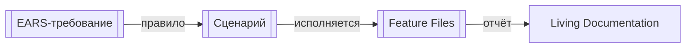

# Сценарии приёмки (Acceptance Scenarios)

> [!info] Определение
> Конкретные примеры поведения в формате Given/When/Then: контекст, событие, результат.
> Исполняемая форма критериев приёмки; основа [[Feature Files]]. См. [[EARS-требования]].

## Стандарт / источник

- **Gherkin** (Cucumber, ~2008), BDD/ATDD. См. [[Feature Files]].
- В [[OpenSpec]]: сценарии внутри delta specs.
- В [[GitHub Spec Kit]]: критерии приёмки пользовательских историй.

## Формат

```gherkin
Scenario: Применение SAVE10 к корзине 50.00
  Given a cart totalling 50.00
  When the user applies code "SAVE10"
  Then the order total shows "45.00"
```

## Правила стиля

- Декларативные шаги (намерение), а не императивные («click button X»).
- 2–5 сценариев на правило; исчерпывающие случаи — юнит-тестами.
- Каждое Then — наблюдаемый результат: экран, сообщение, значение.

## Пример (связь с EARS)

```markdown
EARS: WHEN пользователь применяет валидный промокод, the checkout page SHALL
показать скидочную сумму.

Gherkin (пример правила):
Scenario: Apply SAVE10
  Given a cart totalling 50.00
  When the user applies code "SAVE10"
  Then the order total shows "45.00"
```

## Диаграмма



## Мнемоника

**«Дано — Когда — Тогда»** — ДКТ: контекст, событие, результат.

## Связи

- [[EARS-требования]] · [[Feature Files]] · [[Пользовательские истории]] · [[Требования]]

## Типичные ошибки

> [!warning]
> Императивные шаги привязывают тесты к UI. Сквозные браузерные тесты для доменной
> логики — медленные и волатильные.
