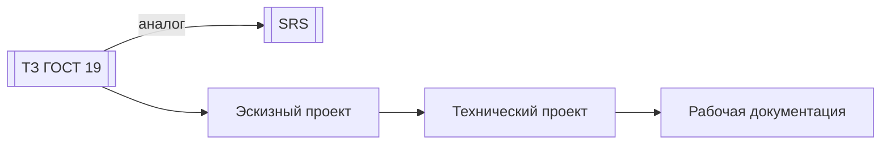

# ТЗ по ГОСТ 19 (ЕСПД)

> [!info] Определение
> Техническое задание по ГОСТ 19.201-78 — российский аналог SRS: требования заказчика,
> критерии приёмки. Часть Единой системы программной документации (ЕСПД).
> См. [[SRS]], [[ГОСТ 19]].

## Стандарт / источник

- **ГОСТ 19.201-78** — Техническое задание (ТЗ).
- Серия ГОСТ 19: 19.202-78 (эскизный проект), 19.401-78 (текст программы),
  19.402-78 (описание программы), 19.404-79 (пояснительная записка),
  19.501-78 (описание применения), 19.502-78 (описание алгоритма),
  19.503-79 (руководство программиста), 19.504-79 (руководство оператора),
  19.505-79 (руководство пользователя), 19.506-79 (описание языка),
  19.701-90 (схемы алгоритмов).

## Формат

| Аспект | Значение |
|---|---|
| Стандарт | ГОСТ 19.201-78 |
| Стадия | Разработка ТЗ (первая стадия жизненного цикла по ГОСТ 19) |

## Содержание ТЗ

1. Введение
2. Основания для разработки
3. Назначение разработки
4. Требования к программе / программному изделию
5. Требования к программной документации
6. Технико-экономические показатели
7. Порядок контроля и приёмки

## Пример (фрагмент)

```markdown
## 4. Требования к программе

4.1 Программа должна обеспечивать:
- ввод данных через web-интерфейс;
- формирование отчёта в PDF в течение 2 секунд.

4.2 Требования к надёжности: время восстановления ≤ 1 часа.

## 7. Порядок контроля и приёмки
Приёмка — по программе и методике испытаний; критерии — раздел 4.
```

## Диаграмма



## Мнемоника

**«Введение, Основания, Назначение, Требования, Документация, Показатели, Приёмка»** — ВОНТДПП.

## Связи

- [[ГОСТ 19]] · [[SRS]] · [[BRD]] · [[Спецификация]]

## Типичные ошибки

> [!warning]
> ТЗ без критериев приёмки в разделе 7: приёмка превращается в спор.
> Смешение ТЗ и эскизного проекта (что vs как).
