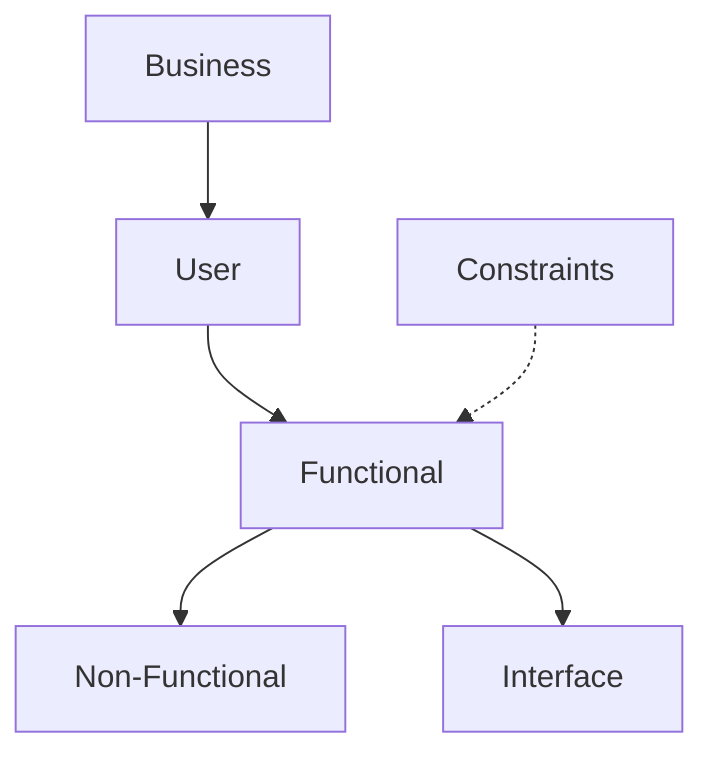

# Требования (Requirements)

> [!info] Определение
> Атомарные проверяемые утверждения о системе: что она делает (FR) и как хорошо (NFR).
> Ядро [[Спецификация|спеки]] и [[SRS]]. См. [[EARS-требования]], [[Пользовательские истории]],
> [[Матрица трассируемости]].

## Стандарт / источник

- [[ISO 29148]]: типы требований, атрибуты (Id, Priority, Rationale, Verification Method)
- [[IEEE 830]] §3: functional, performance, design constraints, attributes
- [[INCOSE Guide]]: правила написания (одно обязательство, измеримость, активный залог)

## Формат

| Аспект | Значение |
|---|---|
| ID | FR-001, NFR-001, REQ-CART-01 |
| Нотация | [[EARS-требования]] или «The system shall…» |
| Атрибуты | Id, Priority, Source, Rationale, Type, Status, Verification Method |

## Типы требований

| Тип | Вопрос | Пример |
|---|---|---|
| Business | Зачем строим? | Сократить обработку заказов на 40% |
| User | Что нужно человеку? | Менеджер видит остатки по 3 площадкам |
| Functional | Что делает система? | Отображение остатка по SKU |
| Non-Functional | Как хорошо? | Обновление ≤ 3 секунд |
| Interface | Как взаимодействует? | REST API, OpenAPI |
| Constraint | Ограничения? | Только PostgreSQL, данные в EU |

## Пример

```markdown
- **FR-001** (Test): WHEN пользователь применяет валидный промокод, the checkout page
  SHALL показать скидочную сумму. Rationale: конверсия.
- **NFR-001** (Test): страницы SHALL загружаться ≤ 3 с при ≤ 5000 пользователей.
```

## Диаграмма



## Мнемоника

**«Бизнес, Пользователь, Функции, Нефункции»** — БПФН.

## Связи

- [[EARS-требования]] · [[Спецификация]] · [[Сценарии приёмки]] · [[Матрица трассируемости]] · [[SRS]]

## Типичные ошибки

> [!warning]
> «Система должна быть быстрой» — неверифицируемо. Требование без метода верификации —
> пожелание, а не требование.
