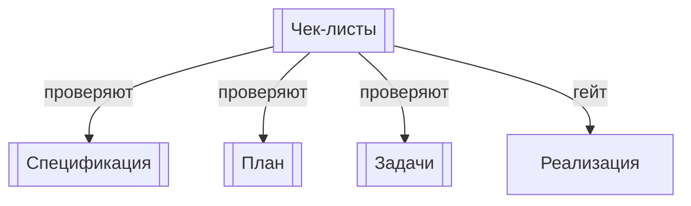

# Чек-листы (Checklists)

> [!info] Определение
> Контрольные списки качества требований и артефактов. Генерируются командой
> `/speckit.checklist`; встраиваются в [[Спецификация|spec.md]] или отдельным файлом.
> См. [[Спецификация]], [[План]], [[Задачи]].

## Стандарт / источник

- [[GitHub Spec Kit]]: `/speckit.checklist`, `checklists/` в папке фичи
- [[OpenSpec]]: чек-лист качества дельт в `docs/writing-specs.md`

## Формат

| Аспект | Значение |
|---|---|
| Расположение | `specs/NNN-name/checklists/` или секция в spec.md |
| Синтаксис | Markdown, чекбоксы |

## Содержание (типовой чек-лист требований)

- [ ] Каждое требование имеет ID и метод верификации
- [ ] Нет слов без чисел («быстро», «удобно»)
- [ ] Error/edge cases покрыты IF/THEN
- [ ] NFR измеримы
- [ ] Out of scope перечислен
- [ ] Конституция проверена
- [ ] Задачи трассируются к требованиям

## Диаграмма

## Мнемоника

**«ID, Числа, Ошибки, Измерения, Scope, Конституция, Трассировка»** — ИЧОИСКТ.

## Связи

- [[Спецификация]] · [[План]] · [[Задачи]] · [[Конституция]] · [[Матрица трассируемости]]

## Типичные ошибки

> [!warning]
> Чек-лист, который никто не проходит перед implement: гейт существует только на бумаге.
